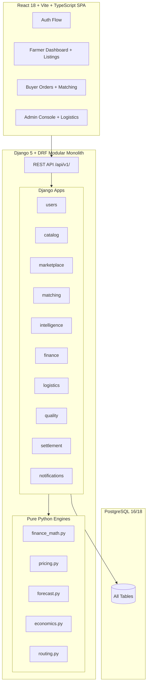

# KuralAgri SIH MVP — Implementation Plan

## Goal

Build a **working, demo-ready MVP** of KuralAgri — an agricultural marketplace that aggregates smallholder farmers' produce into graded Lots for bulk buyers, with explainable pricing, protected farmer floors, logistics optimization, and transparent settlement. The complete end-to-end transaction must work through the UI using seeded demo data.

## System Architecture

> [!IMPORTANT]
> The spec mandates: `intelligence` never computes a floor. `logistics` never decides a price. `finance` never chooses a destination. Module boundaries are enforced via `services.py` public functions.

---

## Milestones Summary

- **M1 — Foundation**: Docker, PostgreSQL, Django skeleton, common utilities, catalog, notifications. [COMPLETE]
- **M2 — Financial Engine**: Pure Python floor price, advance, interest, min viable lot price, escrow waterfall, crop failure. Gating test suite verifying D1 §10 to the paisa. [COMPLETE]
- **M3 — Identity**: Phone-based auth, FarmerProfile, BuyerProfile, JWT tokens, RBAC, audit logging. [COMPLETE]
- **M4 — Marketplace**: Produce listings, remaining shelf-life computation, buyer requirements. [IN PROGRESS]
- **M5 — Intelligence**: Mandi price benchmarks, 7-day seasonal-naive demand forecast, price recommendation range with explainability factor builder. [IN PROGRESS]
- **M6 — Matching & Lots**: Multi-farmer matching, greedy scored fill, shortfall policy (WAIT/PARTIAL/REJECT), Lot formation.
- **M7 — Logistics**: Transport economics, destination feasibility filter, vehicle assignment, OR-Tools CVRP routing.
- **M8 — Escrow & Settlement**: Escrow funding, advance release, waterfall pro-rata settlement, append-only ledger.
- **M9 — Quality & Recovery**: Intake verification, handover check, rejection recovery search (secondary buyer / processor / waste).
- **M10 & M11 — Frontend SPA**: Role-aware React 18 SPA (Farmer, Buyer, Admin), Leaflet routing map, explainability cards.
- **M12 — Demo Hardening**: Full §16 demo dataset seed command, end-to-end integration tests, rehearsal.
