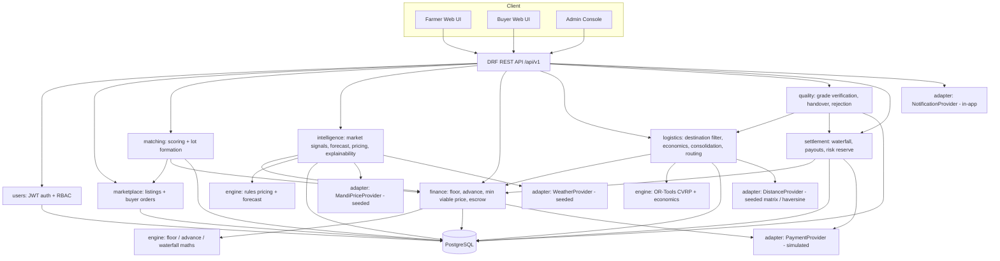
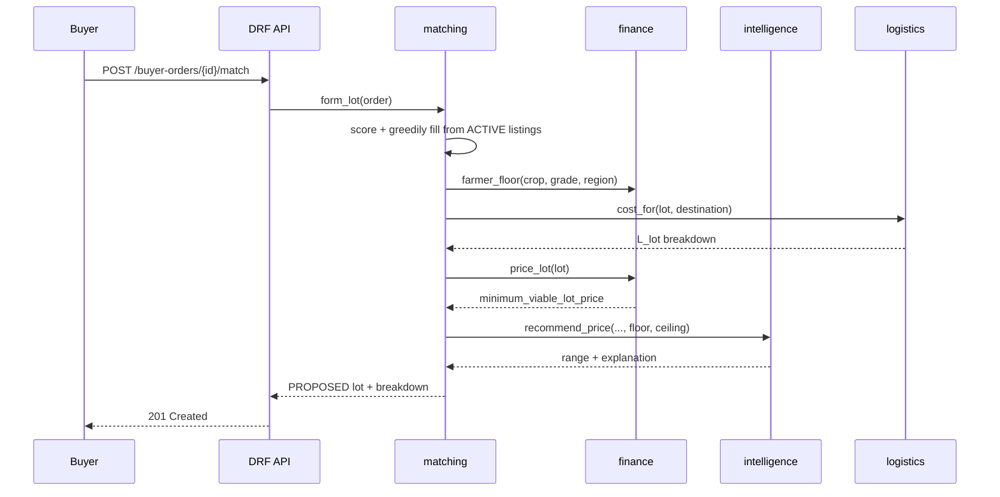
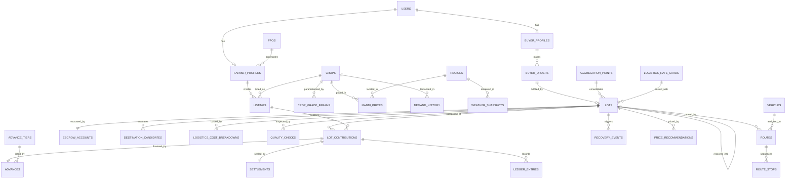

# SIH MVP — Technical Specification

**Project:** KuralAgri — Produce Destination, Pricing & Settlement Marketplace
**Deliverable:** Working MVP / prototype for Smart India Hackathon
**Audience:** Google Antigravity (primary implementing agent) and the human build team
**Status:** Authoritative build spec. Where this document and the three source documents disagree, **this document wins** — every deviation is recorded in §0.4.

---

## 0. Source Analysis & Architectural Decisions

### 0.1 Source documents

| Doc | Team | Owns | Core contribution |
|---|---|---|---|
| D1 | Team 1 | Financial & Risk Architecture (v4, Lot-based) | Floor price, point-of-sale advance, logistics cost model, minimum viable Lot price, escrow waterfall, pro-rata settlement, crop-failure/risk reserve |
| D2 | Team 2 | AI, Market Intelligence & Pricing | Market intelligence, demand forecasting, price recommendation, price-floor constraint, buyer–farmer matching, explainability |
| D3 | Team 3 | Logistics, Quality & Processing (E-Sandhai) | Destination filter, transport economics, grade-based destination matching, secondary markets, processors, load consolidation, vehicle capacity, shelf-life, OR-Tools routing, rejection recovery |

### 0.2 Consolidated problem statement

Smallholder farmers in Tamil Nadu sell through intermediaries who pay roughly 60% of the mandi price, receive payment late, carry all spoilage risk, and have no visibility into where their produce could profitably go. Bulk buyers, in turn, cannot reliably source a verified quantity of a single grade from smallholders.

KuralAgri is an **asset-light** marketplace that:

1. aggregates multiple farmer/FPO contributions into a single graded **Lot** that satisfies a bulk **Buyer Order**;
2. prices the Lot with an explainable, rules-based intelligence layer constrained by a **protected farmer floor** and a **minimum viable price** that already includes logistics;
3. pays farmers a **point-of-sale advance** at Lot confirmation instead of after delivery;
4. finds an **economically viable, physically reachable destination** for each grade before the produce spoils, including secondary buyers and processors for rejected or lower-grade produce;
5. settles every contributor individually through an escrow waterfall, with defaults isolated to the defaulting contributor.

KuralAgri owns no warehouses, no cold storage, no vehicles and no inventory. It coordinates farmers, FPOs, aggregation partners, transporters, buyers and a lending partner.

### 0.3 Extracted requirements

**Users / actors:** Farmer, FPO (acts as collector for member farmers), Bulk Buyer (premium / secondary / processor), Platform Admin (ops). Lender (NBFC), aggregation partner and transporter appear as *data*, not as logged-in users, in the MVP.

**Functional:** registration & role-based access; produce listing with crop/grade/quantity/location/harvest time; buyer requirement posting; market intelligence; demand forecast; price recommendation with explanation; floor enforcement; multi-farmer matching and Lot formation; grade verification gate; destination feasibility + economics; load consolidation; vehicle-capacity-constrained routing; delivery tracking by status; quality check at handover; rejection recovery to secondary buyer or processor; escrow funding; waterfall distribution; per-contributor advance and settlement; crop-failure handling; risk reserve ledger.

**Non-functional:** runs end-to-end on seed data with no live external dependency; single `docker compose up` local start; any AI/optimisation call returns in < 3 s or falls back deterministically; mobile-first farmer UI; every price shown with a reason; demo reproducible on demand.

**AI/ML:** market intelligence signals, near-term demand forecast, price-range recommendation, buyer–farmer matching, explainability. D2 explicitly states rules/statistics are acceptable for the MVP with ML "later"; there is no historical transaction corpus, so **no deep learning is used**.

**Logistics:** shelf-life and travel-time feasibility, transport economics, grade→destination routing, consolidation, vehicle capacity as a hard constraint, delivery deadlines, OR-Tools routing, rejection recovery.

**Financial:** floor price, tiered advance and interest, per-contributor lender claim and residual, Lot-level logistics cost, minimum viable Lot price, buyer ceiling, escrow waterfall, pro-rata settlement by residual entitlement, risk reserve, crop-failure default handling.

**Trust:** verified weight per contributor, grade verification before consolidation, explainable pricing, escrow funded before collection, full audit trail of every financial event, no silent under-fill.

**Constraints:** hackathon timeline; no real payment licence; no mandi/weather data contract; no real NBFC; no CV grading dataset; no fleet.

### 0.4 Conflicts found and how they are resolved

| # | Conflict / duplication | Resolution (binding) |
|---|---|---|
| C1 | Product named KuralAgri (D1, D2) and E-Sandhai (D3) | Single product name **KuralAgri**. `E-Sandhai` retained only as the internal name of the logistics module's positioning line. |
| C2 | **Flow direction.** D1/D2 are demand-pull (Buyer Order → match farmers → Lot). D3 is supply-push (farmer has produce → find a destination). | One pipeline, two entry points. A **Lot** is the single unit. `DEMAND_PULL` (Buyer Order first) is the **primary demo path**. `SUPPLY_PUSH` (listing seeks a destination) reuses the identical destination engine and is required only for **rejection recovery** and Grade B/C placement. No duplicate code path. |
| C3 | **Two logistics cost models.** D1 §5.3 computes collection + handling + trunk + urgency. D3 §4 computes `revenue − transport − handling`. | D1's formula is the **single source of truth** for cost. D3's net-return comparison is a *consumer* of it: `net_return = gross_revenue − L_lot(destination) − platform% − reserve%`. There is exactly one `LogisticsCostService`. |
| C4 | **Two "floors".** D2 §4 calls ₹25/kg a price floor; D1 §7 defines a minimum viable Lot price that includes logistics and interest. | Two distinct, both enforced: `farmer_floor F` (crop+grade property, protects the farmer) and `minimum_viable_lot_price` (protects the transaction). **Binding rule:** a recommendation must satisfy `price ≥ max(F, minimum_viable_lot_price)`. Team 2 never computes a floor itself. |
| C5 | **Aggregation duplicated.** D1 §5 aggregation point vs D3 §8 load consolidation. | Same concept, one module `logistics.consolidation`. The aggregation point is a physical node; consolidation is the decision to use it. D1's tiered trunk rate is applied to the consolidated Lot quantity. |
| C6 | **Shelf life.** D1 perishability class A ≈ 2 days; D3 tomato = 10 hours usable life. | Two different fields, both kept. `perishability_class` (crop-level, drives the interest accrual window `d`) and `remaining_shelf_life_hours` (listing-level, computed from `harvest_datetime` and crop `usable_life_hours`). Logistics uses the second; finance uses the first. |
| C7 | **Grade verification owner.** D1 assigns it to Team 3; D3 says it comes from "the quality module". | MVP: grade is **farmer-declared, then admin/aggregation-verified** through an explicit `QualityCheck` record at intake. No computer-vision grading. |
| C8 | D1 §6 offers FPO-as-collector and FPO-as-institutional-borrower; the worked example uses the non-default mode | MVP implements **FPO-as-collector only** (the stated default). Institutional-borrower is `FUTURE`. Because the demo scenario reproduces D1 §10 exactly, the FPO block is modelled there as a single contributor with a `10+` tier — arithmetically identical, and flagged in the UI. |
| C9 | D1 escrow assumes a real NBFC + PMFBY; D2/D3 assume none | All money movement is a **simulated ledger**. No payment gateway, no NBFC API, no PMFBY API. The maths is real; the rails are mocked and labelled in the UI. |
| C10 | D3 lists cold storage as "optional"; D3 §14 removes real-time cold-storage management | Cold storage is **removed entirely** from the MVP, including as a destination type. It is `FUTURE`. |
| C11 | D2 lists weather as a forecasting input; there is no weather contract | Weather is a **seeded table** with an optional live provider behind a feature flag, defaulting off. Never a demo dependency. |
| C12 | D1's illustrative trunk rate (₹0.45/kg/km) produces ₹9/kg for a 20 km haul — implausibly high for a real 500 kg shipment | The formula is implemented **exactly as specified** and all rates live in a `logistics_rate_card` table so the D1 §10 worked example reproduces to the paisa. Calibration is flagged in §19 as a pilot-validation item, not silently "fixed". |

### 0.5 Non-negotiable engineering principles

1. **Every rupee constant lives in the database**, never in code. Rate cards, tiers, crop parameters and grade multipliers are seeded rows.
2. **Money is `NUMERIC(12,2)`**, quantities are `NUMERIC(10,2)` kg. No floats for money anywhere.
3. **Every financial event is an append-only ledger row.** Balances are derived, never mutated in place.
4. **Every AI output carries an `explanation` JSON payload** with the signals that produced it. An unexplained number is a bug.
5. **Every AI/optimiser call has a deterministic fallback** so the demo cannot break.
6. **One crop + one grade per Lot.** Enforced at the database level.

---

## 1. MVP Scope

Classification: `MUST_BUILD` (demo fails without it) · `SHOULD_BUILD` (build after all MUST items pass) · `MOCK` (real interface, simulated backend, labelled in UI) · `FUTURE` (documented, not built) · `REMOVE` (deliberately deleted from scope).

| Feature | Priority | Implementation | Reason |
|---|---|---|---|
| Phone/email + password auth, JWT | MUST_BUILD | Real | Every journey is role-gated |
| Roles: FARMER, FPO, BUYER, ADMIN | MUST_BUILD | Real | Derived from all three docs |
| Farmer produce listing (crop, grade, qty, location, harvest time) | MUST_BUILD | Real | Entry point of supply side |
| Remaining shelf-life computation | MUST_BUILD | Real | Drives D3's central constraint |
| Buyer Order (crop, grade, qty, deadline, ceiling, partial flag) | MUST_BUILD | Real | Entry point of demand side (D1 §2) |
| Market Intelligence signals | MUST_BUILD | Rules over seeded mandi/arrival/order data | D2 component 1 |
| Demand forecast (7-day) | MUST_BUILD | Seasonal-naive + trend + season/weather multipliers | D2 component 2; explicitly "rules/sample data first" |
| Price recommendation range | MUST_BUILD | Deterministic weighted-adjustment rules | D2 component 3 |
| Farmer floor price `F` | MUST_BUILD | Real (D1 §4 formula) | Core differentiator |
| Minimum viable Lot price | MUST_BUILD | Real (D1 §7 closed form) | Hard constraint on pricing |
| Buyer–farmer matching + Lot formation | MUST_BUILD | Greedy scored matcher | D2 component 5; D1 §2 |
| Supply-shortfall policy (wait / partial / reject) | MUST_BUILD | Real (D1 §11) | Prevents silent under-fill |
| Grade verification gate at intake | MUST_BUILD | Manual QualityCheck record | D1 §13; D3 §5 |
| Destination feasibility filter (travel time + shelf life + capacity + deadline) | MUST_BUILD | Real (D3 §3, §11) | D3's headline claim |
| Destination economics ranking | MUST_BUILD | Real (D3 §4 over D1's cost model) | Prevents "highest price wins" |
| Grade → destination channel mapping (A/B/C) | MUST_BUILD | Rules table | D3 §5 |
| Secondary-buyer search | MUST_BUILD | Real | D3 §6; anti-waste demo |
| Load consolidation decision (direct vs aggregated) | MUST_BUILD | Real (D1 §5.4 + D3 §8) | Drives the trunk-rate tier |
| Logistics cost engine (collection/handling/trunk/urgency) | MUST_BUILD | Real (D1 §5.3) | Feeds price and economics |
| Escrow waterfall + per-contributor settlement | MUST_BUILD | Simulated ledger (real maths) | D1 §9 |
| Point-of-sale advance + tiered interest | MUST_BUILD | Simulated ledger (real maths) | D1 §4 |
| Order/Lot status lifecycle + tracking stepper | MUST_BUILD | Real | Replaces GPS tracking |
| Explainability cards (price, forecast, match, destination) | MUST_BUILD | Real | D2 component 7 |
| Seed/demo dataset + one-click reset | MUST_BUILD | Real | Demo reproducibility |
| Farmer, Buyer and Admin dashboards | MUST_BUILD | Real | Required to show anything |
| OR-Tools capacitated route + pickup sequence | SHOULD_BUILD | Real (CVRP, capacity + deadline) | D3 §12; MUST have a nearest-neighbour fallback |
| Rejection recovery flow (reject → secondary → processor) | SHOULD_BUILD | Real | D3 §13; strongest demo moment |
| Processor as destination type | SHOULD_BUILD | Real (simple matching, D3 §7) | Grade-C value recovery |
| Crop-failure / default toggle + risk reserve payout | SHOULD_BUILD | Simulated ledger (real maths) | D1 §12; strong risk story |
| Admin market-data console | SHOULD_BUILD | Real | Lets judges see the inputs |
| Payment gateway / UPI / bank transfer | MOCK | Button → ledger state change, labelled "Simulated" | No licence, no accounts |
| NBFC advance disbursal | MOCK | Ledger entry from a seeded lender account | No lending partner |
| Mandi price feed (Agmarknet) | MOCK | Seeded 120-day history; adapter interface ready | No reliable API access in hackathon window |
| Weather data | MOCK | Seeded snapshots; live provider behind disabled flag | Never a demo dependency |
| SMS / IVR / WhatsApp notification | MOCK | In-app notification rows + a "message preview" panel | Telephony needs paid accounts |
| Road distance / travel time | MOCK | Seeded distance matrix; haversine × 1.35 road factor fallback; OSRM adapter optional | Deterministic demo beats a live routing API |
| Grade verification photo | MOCK | Upload stored, shown, not analysed | No CV model or dataset |
| PMFBY crop insurance integration | FUTURE | — | Government integration, out of scope |
| ML demand forecasting (XGBoost etc.) | FUTURE | — | No transaction history exists yet; D2 says ML "as data accumulates" |
| FPO as institutional borrower | FUTURE | — | D1 §6 explicitly Phase 2 |
| Cold storage as destination / storage decision | FUTURE | — | D3 §14–15: not the core problem |
| Dynamic rerouting on cancellation | FUTURE | — | D3 §14: REMOVE from MVP |
| Empty-return optimisation | FUTURE | — | D3 §14: DEFER |
| Waste / recovery analytics dashboard | FUTURE | — | Nice-to-have reporting |
| Multi-language UI (full TA translation) | FUTURE | i18n scaffolding + Tamil crop names only | Translation effort ≠ engineering value at demo |
| Separate algorithms per vehicle type | REMOVE | — | D3 §14: model vehicles as data (capacity, cost/km) |
| Real-time cold-storage capacity management | REMOVE | — | D3 §14 |
| Complex processing optimisation | REMOVE | — | D3 §14: simple matching is enough |
| Live GPS tracking / driver app | REMOVE | — | Needs a fleet; status stepper conveys the same information |
| Consumer / retail B2C storefront | REMOVE | — | D1 §2: the MVP customer is the bulk buyer |
| Seasonal input financing | REMOVE | — | The advance is explicitly point-of-sale, not a pre-season loan |
| Blockchain traceability | REMOVE | — | Not in any source document |
| Native mobile app | REMOVE | — | Responsive PWA-style web app is sufficient |
| Real-time chat / bargaining | REMOVE | — | Pricing is engine-driven, not negotiated |
| Microservices, Kafka, event sourcing | REMOVE | — | Modular monolith is correct at this scale |

**Scope guard for Antigravity:** do not build anything not listed above. If a requirement seems implied but is absent from this table, it is out of scope.

---

## 2. User Journeys

Status values referenced here are defined normatively in §13.

### Journey 1 — Farmer creates a listing and sees an explained price

- **Actor:** Farmer (or FPO on behalf of members)
- **Trigger:** Farmer has harvested produce and opens "Create Listing"
- **Steps:** select crop → select grade (A/B/C) → enter quantity in kg → confirm village/district (pre-filled from profile, editable pin) → enter harvest date & time → submit → view the Price Intelligence card → publish or save as draft
- **Backend operations:** validate payload → compute `remaining_shelf_life_hours` → call `MarketIntelligenceService` for the crop+district → call `DemandForecastService` (7-day horizon) → call `PricingService.recommend()` → call `FinanceService.farmer_floor()` → clamp the recommendation to the floor → persist
- **Database operations:** `INSERT listings` (status `ACTIVE`); `INSERT price_recommendations` linked to the listing; `INSERT audit_log`
- **AI operations:** market signals (price trend, supply trend, demand signal, weather risk); 7-day demand forecast; price range with explanation payload
- **Final result:** an `ACTIVE` listing visible to matching, plus a farmer-facing card: benchmark, floor, demand/supply signals, recommended range, confidence, and the "why" bullet list.

### Journey 2 — Buyer posts a requirement and receives a matched, priced Lot

- **Actor:** Bulk Buyer
- **Trigger:** Buyer needs a graded quantity by a deadline
- **Steps:** create requirement (crop, grade, quantity, delivery location, deadline, max price, sourcing preference, allow-partial flag + minimum acceptable quantity) → run "Find Supply" → review the proposed Lot (contributors, quantities, distances) → review the price breakdown → accept or reject
- **Backend operations:** `MatchingService` selects `ACTIVE` listings matching crop + grade with sufficient remaining shelf life to reach the delivery location; scores them by distance, quantity fit, shelf-life margin and farmer tier; greedily fills the requirement → `LotService.form()` creates a provisional Lot and per-contributor rows → `FinanceService.price_lot()` computes `F`, per-contributor `V_i/A_i/I_i/N_i`, `L_lot`, and `minimum_viable_lot_price` → `PricingService` recommends a final price inside `[minimum_viable_lot_price, buyer_ceiling]` → shortfall policy applied if under-filled
- **Database operations:** `INSERT lots` (status `PROPOSED`); `INSERT lot_contributions` × n; `UPDATE listings` → `RESERVED`; `INSERT price_recommendations`; `INSERT logistics_cost_breakdowns`
- **AI operations:** matching score; price recommendation constrained by the finance floor; explanation payload
- **Final result:** a `PROPOSED` Lot with a full, itemised price breakdown, or an explicit shortfall decision (`WAIT` / `PARTIAL` / `REJECT`) per D1 §11.

### Journey 3 — Destination feasibility & economics (the E-Sandhai decision)

- **Actor:** System (triggered by Lot formation; visible to Admin and, in summary, to the Farmer)
- **Trigger:** Lot reaches `PROPOSED`, or a listing is placed on the supply-push path (Grade B/C, or rejected produce)
- **Steps:** enumerate candidate destinations (premium buyers, secondary buyers, processors) → filter → compute economics → rank → select
- **Backend operations:** for each candidate — check grade acceptance, daily capacity, order deadline, and `travel_time_hours + safety_buffer ≤ remaining_shelf_life_hours`; infeasible candidates are retained with a `rejection_reason` (they are shown in the UI, which is the point); for feasible candidates compute `L_lot` for that destination and `net_return_per_kg = (gross_price − L_lot/Q) × (1 − platform% − reserve%)`; rank by net return
- **Database operations:** `INSERT destination_candidates` × n (feasible and infeasible); `UPDATE lots.selected_destination_id`
- **AI operations:** none — this is deterministic economics, deliberately
- **Final result:** a ranked destination table where the highest-priced buyer may be visibly rejected on shelf life or net return, with the reason shown.

### Journey 4 — Escrow funding and point-of-sale advance

- **Actor:** Buyer, then System
- **Trigger:** Buyer accepts the Lot price
- **Steps:** buyer clicks "Fund Escrow (Simulated)" → sees the full waterfall preview → confirms → each contributing farmer is notified that their advance has been released
- **Backend operations:** create escrow account for the Lot; record the buyer deposit; for each contributor create an `advance` ledger entry of `A_i = V_i × advance_rate(tier_i)` and accrue `I_i = A_i × r_i × d/365`; move the Lot to `ESCROW_FUNDED`; release collection to logistics
- **Database operations:** `INSERT escrow_accounts`, `INSERT ledger_entries` (buyer deposit, n advance disbursals, n interest accruals); `UPDATE lots.status`; `UPDATE lot_contributions` with `advance_amount`, `interest_amount`, `lender_claim`
- **AI operations:** none
- **Final result:** money is escrowed before collection (D1 §13 counterparty mitigant); farmers see their advance credited before the produce has moved.

### Journey 5 — Collection, consolidation and routing

- **Actor:** Admin / ops (acting for aggregation and transport partners)
- **Trigger:** Lot is `ESCROW_FUNDED`
- **Steps:** open the Logistics Planner → review the consolidation decision (direct vs aggregated, with the trunk-rate tier shown) → run "Optimise Route" → review stop sequence, vehicle assignment, distance, cost and ETA → dispatch → mark each pickup collected (verified weight per contributor) → mark delivered
- **Backend operations:** `ConsolidationService` compares direct-shipment cost against aggregated cost at `Q_lot`; `RoutingService` builds the distance/time matrix and solves a capacity-constrained pickup-and-delivery problem with OR-Tools (5-second limit), falling back to nearest-neighbour insertion; each pickup records a verified weight that overwrites the self-reported quantity in the financial engine
- **Database operations:** `INSERT routes`, `INSERT route_stops`; `UPDATE lot_contributions.delivered_quantity_kg`; `INSERT quality_checks` at intake; `UPDATE lots.status` → `IN_TRANSIT` → `DELIVERED`
- **AI operations:** OR-Tools CVRP solve (optimisation, not ML)
- **Final result:** a feasible route respecting vehicle capacity and the delivery deadline, with per-contributor verified weights feeding settlement.

### Journey 6 — Handover quality check, acceptance or rejection recovery

- **Actor:** Buyer, then System
- **Trigger:** Lot marked `DELIVERED`
- **Steps:** buyer inspects → accepts the full quantity, or rejects a quantity with a reason → on rejection the recovery engine immediately searches alternatives → admin confirms the recovery destination
- **Backend operations:** `INSERT quality_checks` (stage `HANDOVER`); on full acceptance the escrow waterfall runs; on partial rejection the accepted portion settles and the rejected quantity spawns a **recovery Lot** which re-enters Journey 3 with the *remaining* shelf life (now shorter), searching secondary buyers then processors; if nothing is feasible the quantity is recorded as `WASTE` with the reason
- **Database operations:** `INSERT quality_checks`; `INSERT lots` (recovery Lot, `parent_lot_id` set); `INSERT recovery_events`; `INSERT destination_candidates`
- **AI operations:** none (deterministic), but the secondary-buyer ranking reuses the destination economics
- **Final result:** rejection becomes a second sale rather than a dead transaction — with the value actually recovered displayed in rupees.

### Journey 7 — Settlement

- **Actor:** System, visible to Farmer and Buyer
- **Trigger:** Lot reaches `ACCEPTED`
- **Steps:** waterfall executes → each contributor sees advance + settlement + total, and a comparison against traditional-channel realisation
- **Backend operations:** `total_received = agreed_price × Q_delivered`; pay `lender_claim_lot` → `platform_rate × total_received` → `L_lot` → `reserve_rate × total_received`; the remaining `farmer_pool` is split pro-rata by residual entitlement `N_i / N_lot`; `farmer_total_i = A_i + settlement_i`
- **Database operations:** `INSERT ledger_entries` (one per waterfall line, one per contributor settlement); `INSERT settlements`; `UPDATE lots.status` → `SETTLED`; `UPDATE farmer_profiles.completed_orders` (which may promote the tier); `INSERT risk_reserve_ledger`
- **AI operations:** none
- **Final result:** every rupee received is accounted for, and the sum of all outflows equals `total_received` exactly.

### Journey 8 — Crop failure / contributor default

- **Actor:** Admin (demo toggle) or a zero verified weight at pickup
- **Trigger:** a contributor delivers 0 kg
- **Steps:** contributor marked `FAILED` → Lot quantity recomputed → shortfall policy re-applied → risk reserve covers part of the lender's exposure
- **Backend operations:** the failed contributor's `lender_claim_i` is written off against the risk reserve at `reserve_default_cover_rate` (seeded 40%); the remainder is an unrecovered lender loss; the farmer carries **no cash liability**; all other contributors' settlements are computed from their own `N_i` and are numerically unaffected
- **Database operations:** `UPDATE lot_contributions.status = FAILED`; `INSERT risk_reserve_ledger` (debit); `INSERT ledger_entries` (write-off); `UPDATE lots.total_quantity_kg`
- **AI operations:** none
- **Final result:** a visible demonstration that one farmer's failure neither penalises other contributors nor creates farmer debt.

---

## 3. System Architecture

### 3.1 Style

**Modular monolith.** One Django project, one PostgreSQL database, one deployable backend, one React SPA. The domain modules are Django apps with explicit service layers and no cross-app ORM reach-through: a module talks to another module only through its `services.py` public functions. This keeps module boundaries honest (so a service can be extracted later) without paying any distributed-systems cost during a hackathon.

**Rationale against alternatives:** microservices would add network failure modes and deployment surface for zero MVP benefit; a pure-FastAPI stack would mean hand-building the admin console, auth and migrations that Django gives for free — and the Admin console is doing real work in this demo.

### 3.2 Layers

| Layer | Responsibility |
|---|---|
| **Frontend** (React SPA) | Role-aware routing, forms, dashboards, explainability cards, map/route visualisation. No business rules — it never recomputes a price. |
| **API layer** (DRF) | Versioned REST under `/api/v1/`, JWT auth, serializer validation, role permissions, consistent error envelope, OpenAPI schema. |
| **Domain modules** | `users`, `catalog`, `marketplace`, `matching`, `intelligence`, `finance`, `logistics`, `quality`, `settlement`, `notifications`, `admin_ops`. |
| **Engine layer** (pure Python) | Deterministic calculators and solvers: pricing rules, forecast, floor/advance/waterfall maths, destination economics, OR-Tools model. No Django imports, fully unit-testable. |
| **Data layer** | PostgreSQL 16. Append-only ledgers for money. All parameters in seeded tables. |
| **External adapters** | `MandiPriceProvider`, `WeatherProvider`, `DistanceProvider`, `PaymentProvider`, `NotificationProvider` — each an interface with a `Seeded*` implementation used by default and a `Live*` stub behind a feature flag. |

### 3.3 Cross-module contracts (binding)

```text
intelligence.recommend_price(crop, grade, region, qty, floor, ceiling) -> PriceRecommendation
finance.farmer_floor(crop, grade, region_price)                        -> Decimal            # only finance may compute this
finance.price_lot(lot)                                                 -> LotPricing         # min viable price + full breakdown
logistics.cost_for(lot, destination)                                   -> LogisticsCost      # the ONLY cost calculator
logistics.rank_destinations(lot)                                       -> list[Candidate]
settlement.run_waterfall(lot)                                          -> WaterfallResult
```

`intelligence` never computes a floor. `logistics` never decides a price. `finance` never chooses a destination. Violating these is the single most likely way this build goes wrong.

### 3.4 Architecture diagram



### 3.5 Request lifecycle for the critical path



---

## 4. Technology Stack

### 4.1 Evaluation

| Technology | Purpose | Reason |
|---|---|---|
| **React 18 + Vite + TypeScript** | Frontend SPA | Fast dev server, typed API contracts prevent an entire class of demo-day bugs, team already knows React |
| **Tailwind CSS + shadcn/ui** | Styling & components | Produces a modern marketplace look quickly without writing a design system; avoids the "generic admin template" failure mode |
| **TanStack Query** | Server state | Caching, loading and error states for every API call with almost no code |
| **React Hook Form + Zod** | Forms & client validation | Mirrors the backend validation rules in §13 with a single schema per form |
| **Recharts** | Price/demand charts | Lightweight, declarative, enough for trend and forecast charts |
| **React-Leaflet + OpenStreetMap tiles** | Map for pickups, destination and route | Free, no API key, no billing account — critical for a hackathon |
| **Django 5 + Django REST Framework** | Backend & API | Batteries-included auth, migrations, ORM and a free Admin console that doubles as the ops tool; team's existing stack |
| **djangorestframework-simplejwt** | Token auth | Standard access/refresh JWT with rotation, minimal configuration |
| **drf-spectacular** | OpenAPI schema | Generates the contract the frontend types are built from |
| **PostgreSQL 16** | Primary datastore | Relational integrity for ledgers, `NUMERIC` money, JSONB for explanation payloads, array fields for accepted grades |
| **Python `decimal`** | Money arithmetic | Non-negotiable; floats produce settlement mismatches |
| **NumPy + Pandas** | Signal and forecast computation | Rolling means, seasonal indices, percentile thresholds over seeded series |
| **Google OR-Tools** | Route optimisation | Explicitly named in D3; solves capacity + sequence properly |
| **Haversine × road factor / seeded matrix** | Distance & travel time | Deterministic, offline, demo-safe; OSRM adapter available but off |
| **Pytest + pytest-django + factory_boy** | Backend testing | Financial maths must be regression-tested against D1 §10 |
| **Vitest + React Testing Library** | Frontend testing | Component and form validation tests |
| **Docker + docker compose** | Local dev & parity | One command brings up db + api + web |
| **Render (backend + Postgres) / Vercel (frontend)** | Deployment | Free tiers, Git-push deploys, no infra work |
| **WhiteNoise** | Static/media serving | Avoids needing S3 for a handful of grade photos |

**Deliberately excluded:** Redis and Celery (no background job in the MVP exceeds ~5 s; OR-Tools runs synchronously with a hard time limit — adding a broker adds a failure mode on demo day); Next.js (no SEO or SSR requirement, and an SPA deploys more simply); scikit-learn/XGBoost (no training data — see §9); Kafka, Elasticsearch, GraphQL, Kubernetes (all unjustified at this scale); Google Maps APIs (billing account requirement).

### 4.2 FINAL STACK

Antigravity must use exactly this. Do not substitute.

```text
Frontend : React 18 + Vite + TypeScript + Tailwind CSS + shadcn/ui
           TanStack Query, React Hook Form + Zod, Recharts, React-Leaflet, axios
Backend  : Python 3.11, Django 5.x, Django REST Framework
           simplejwt (auth), drf-spectacular (OpenAPI), django-cors-headers, django-filter
Database : PostgreSQL 16
Engines  : NumPy, Pandas, Google OR-Tools, Python decimal
External : All external services via adapter classes with seeded implementations (default ON)
Testing  : pytest, pytest-django, factory_boy, Vitest, React Testing Library
Infra    : Docker, docker compose, WhiteNoise
Deploy   : Backend + Postgres on Render; Frontend on Vercel
NOT USED : Redis, Celery, scikit-learn, XGBoost, TensorFlow, Kafka, GraphQL, Next.js, Google Maps
```

---

## 5. Project Structure

```text
kuralagri/
├── docker-compose.yml              # db + backend + frontend, one command
├── README.md                       # setup, seed, demo script
├── .env.example
├── backend/
│   ├── Dockerfile
│   ├── manage.py
│   ├── requirements.txt
│   ├── config/                     # Django project: settings/{base,dev,prod}.py, urls.py, wsgi.py
│   ├── common/                     # shared: base models (UUID + timestamps), error envelope,
│   │                               #   exception handler, pagination, permissions, money utils
│   ├── users/                      # User, FarmerProfile, FPO, BuyerProfile, auth views, RBAC
│   ├── catalog/                    # Crop, CropGradeParam, Region, AggregationPoint, RateCard,
│   │                               #   AdvanceTier — every configurable constant lives here
│   ├── marketplace/                # Listing, BuyerOrder + their APIs
│   ├── matching/                   # scoring, lot formation, shortfall policy; Lot, LotContribution
│   ├── intelligence/               # market signals, demand forecast, price recommendation,
│   │                               #   explanation builder; MandiPrice, WeatherSnapshot, DemandHistory
│   ├── finance/                    # floor, advance tiers, interest, min viable price, escrow,
│   │                               #   LedgerEntry, EscrowAccount, Advance, RiskReserveLedger
│   ├── logistics/                  # destination filter + economics, consolidation, vehicles,
│   │                               #   routes, OR-Tools solver; DestinationCandidate, Vehicle, Route
│   ├── quality/                    # QualityCheck (intake + handover), rejection, RecoveryEvent
│   ├── settlement/                 # waterfall execution, Settlement records, payout view models
│   ├── notifications/              # in-app Notification rows + message templates
│   ├── engine/                     # PURE PYTHON, no Django imports
│   │   ├── pricing.py              #   recommendation rules
│   │   ├── forecast.py             #   seasonal-naive demand forecast
│   │   ├── finance_math.py         #   floor, advance, interest, min viable price, waterfall
│   │   ├── economics.py            #   destination net-return comparison
│   │   └── routing.py              #   OR-Tools CVRP model + nearest-neighbour fallback
│   ├── seed/                       # management command `seed_demo` + CSV/JSON fixture data
│   └── tests/                      # unit (engine), api, integration (full journey)
└── frontend/
    ├── Dockerfile
    ├── index.html, vite.config.ts, tailwind.config.js
    └── src/
        ├── api/                    # axios client, generated types, one hook file per module
        ├── components/             # ui/ (shadcn), cards/ (PriceCard, ExplainCard, StatusStepper),
        │                           #   map/ (RouteMap, PickupMap), layout/
        ├── features/               # auth/, farmer/, buyer/, marketplace/, lot/, logistics/, admin/
        ├── routes/                 # role-aware router
        ├── lib/                    # formatters (₹, kg, dates), constants, zod schemas
        └── styles/
```

**Directory responsibilities are exclusive.** A module owns its models and exposes `services.py`; no other module may import its models directly. `engine/` must remain importable without Django configured — that is what makes the financial maths cheaply testable.

**Do not create:** `payments/` (finance owns the simulated ledger), `storage/`, `coldstorage/`, `analytics/`, `chat/`, `mobile/`, `ml/` (there is no trained model to serve).

---

## 6. Database Design

PostgreSQL 16. Every table has `id UUID PK DEFAULT gen_random_uuid()`, `created_at TIMESTAMPTZ NOT NULL DEFAULT now()`, `updated_at TIMESTAMPTZ NOT NULL DEFAULT now()` unless stated otherwise. Money is `NUMERIC(12,2)`; quantity is `NUMERIC(10,2)`; rates and factors are `NUMERIC(6,4)`.

### 6.1 Identity & organisations

```text
users
- id            UUID PK
- phone         VARCHAR(15)  UNIQUE NOT NULL          # primary login identifier in rural context
- email         VARCHAR(255) UNIQUE NULL
- password_hash VARCHAR(255) NOT NULL
- full_name     VARCHAR(120) NOT NULL
- role          VARCHAR(10)  NOT NULL CHECK (role IN ('FARMER','FPO','BUYER','ADMIN'))
- language      VARCHAR(5)   NOT NULL DEFAULT 'en'    # 'en' | 'ta'
- is_active     BOOLEAN      NOT NULL DEFAULT true
- last_login    TIMESTAMPTZ  NULL
INDEX (role), UNIQUE (phone)

fpos
- id            UUID PK
- name          VARCHAR(160) NOT NULL
- registration_no VARCHAR(60) NULL
- district      VARCHAR(80)  NOT NULL
- latitude      NUMERIC(9,6) NOT NULL
- longitude     NUMERIC(9,6) NOT NULL
- contact_user_id UUID FK -> users(id) NULL
- member_count  INTEGER      NOT NULL DEFAULT 0

farmer_profiles
- id            UUID PK
- user_id       UUID FK -> users(id) ON DELETE CASCADE UNIQUE NOT NULL
- fpo_id        UUID FK -> fpos(id) NULL              # NULL = contributes directly
- village       VARCHAR(120) NOT NULL
- district      VARCHAR(80)  NOT NULL
- latitude      NUMERIC(9,6) NOT NULL
- longitude     NUMERIC(9,6) NOT NULL
- land_size_acres NUMERIC(6,2) NULL
- completed_orders INTEGER   NOT NULL DEFAULT 0       # drives advance tier
- tier          VARCHAR(10)  NOT NULL DEFAULT 'NEW'   # NEW | T1_3 | T4_10 | T10_PLUS (derived, cached)
- self_delivery_capable BOOLEAN NOT NULL DEFAULT false
INDEX (district), INDEX (fpo_id)

buyer_profiles
- id            UUID PK
- user_id       UUID FK -> users(id) ON DELETE CASCADE UNIQUE NOT NULL
- organisation  VARCHAR(160) NOT NULL
- buyer_type    VARCHAR(12)  NOT NULL CHECK (buyer_type IN ('PREMIUM','SECONDARY','PROCESSOR'))
- accepted_grades VARCHAR(1)[] NOT NULL DEFAULT '{A}' # e.g. {A} | {A,B} | {B,C}
- district      VARCHAR(80)  NOT NULL
- address       TEXT         NOT NULL
- latitude      NUMERIC(9,6) NOT NULL
- longitude     NUMERIC(9,6) NOT NULL
- daily_capacity_kg NUMERIC(10,2) NOT NULL
- min_order_kg  NUMERIC(10,2) NOT NULL DEFAULT 0
- indicative_price_per_kg NUMERIC(12,2) NULL          # processors/secondary buyers quote standing prices
- is_active     BOOLEAN NOT NULL DEFAULT true
INDEX (buyer_type), INDEX (district)
```

### 6.2 Catalog & configuration (all tunable constants)

```text
crops
- id                 UUID PK
- name               VARCHAR(80) UNIQUE NOT NULL
- name_ta            VARCHAR(80) NULL
- msp_per_kg         NUMERIC(12,2) NOT NULL DEFAULT 0     # 0 where no MSP exists (e.g. tomato)
- markdown_factor    NUMERIC(6,4) NOT NULL DEFAULT 0.6000 # D1 §3
- perishability_class CHAR(1) NOT NULL CHECK (perishability_class IN ('A','B','C'))
- expected_days_to_sell INTEGER NOT NULL                  # A=2, B=7, C=30 -> interest window d
- usable_life_hours  INTEGER NOT NULL                     # logistics shelf life (D3 §11)
- urgency_premium_per_kg NUMERIC(12,2) NOT NULL
- retail_markup      NUMERIC(6,4) NOT NULL DEFAULT 1.6500
- unit               VARCHAR(5) NOT NULL DEFAULT 'kg'

crop_grade_params
- id                 UUID PK
- crop_id            UUID FK -> crops(id) ON DELETE CASCADE
- grade              CHAR(1) NOT NULL CHECK (grade IN ('A','B','C'))
- price_multiplier   NUMERIC(6,4) NOT NULL               # A 1.0000 (reference), B 0.8000, C 0.6500
                                                         # applied to the grade-neutral mandi benchmark;
                                                         # used by BOTH the floor and the recommendation,
                                                         # so it is never double-counted
- default_channel    VARCHAR(12) NOT NULL                # PREMIUM | SECONDARY | PROCESSOR (D3 §5)
UNIQUE (crop_id, grade)

regions
- id            UUID PK
- name          VARCHAR(80) UNIQUE NOT NULL   # district-level
- state         VARCHAR(60) NOT NULL DEFAULT 'Tamil Nadu'
- latitude      NUMERIC(9,6) NOT NULL
- longitude     NUMERIC(9,6) NOT NULL

aggregation_points
- id            UUID PK
- name          VARCHAR(160) NOT NULL
- partner_type  VARCHAR(20) NOT NULL   # FPO | COLLECTION_SOCIETY | PARTNER
- fpo_id        UUID FK -> fpos(id) NULL
- region_id     UUID FK -> regions(id) NOT NULL
- latitude      NUMERIC(9,6) NOT NULL
- longitude     NUMERIC(9,6) NOT NULL
- handling_fee_per_kg NUMERIC(12,2) NOT NULL
- is_active     BOOLEAN NOT NULL DEFAULT true

logistics_rate_cards            # D1 §5.3 — versioned so old lots stay reproducible
- id                     UUID PK
- name                   VARCHAR(60) NOT NULL
- collection_rate_per_kg_km NUMERIC(8,4) NOT NULL       # seeded 1.2000
- handling_fee_per_kg    NUMERIC(12,2) NOT NULL          # seeded 0.30
- trunk_tiers            JSONB NOT NULL                  # [{max_kg:500,rate:0.80},{max_kg:2000,rate:0.45}, ...]
- safety_buffer_hours    NUMERIC(5,2) NOT NULL DEFAULT 2 # D3 §3
- road_distance_factor   NUMERIC(6,4) NOT NULL DEFAULT 1.3500
- avg_speed_kmph         NUMERIC(6,2) NOT NULL DEFAULT 35
- effective_from         DATE NOT NULL
- is_active              BOOLEAN NOT NULL DEFAULT true

advance_tiers                   # D1 §4 — reproduces the D1 §10 worked example exactly
- id             UUID PK
- code           VARCHAR(10) UNIQUE NOT NULL  # NEW | T1_3 | T4_10 | T10_PLUS
- min_orders     INTEGER NOT NULL
- max_orders     INTEGER NULL
- advance_rate   NUMERIC(6,4) NOT NULL        # 0.50 / 0.60 / 0.65 / 0.70
- annual_interest_rate NUMERIC(6,4) NOT NULL  # 0.27 / 0.24 / 0.21 / 0.18

platform_settings               # single row
- id                        UUID PK
- platform_commission_rate  NUMERIC(6,4) NOT NULL DEFAULT 0.0400
- risk_reserve_rate         NUMERIC(6,4) NOT NULL DEFAULT 0.0100
- floor_premium             NUMERIC(6,4) NOT NULL DEFAULT 1.1000   # the ×1.10 in D1 §4
- buyer_ceiling_discount    NUMERIC(6,4) NOT NULL DEFAULT 0.8500   # D1 §8
- reserve_default_cover_rate NUMERIC(6,4) NOT NULL DEFAULT 0.4000  # D1 §12
- demo_mode                 BOOLEAN NOT NULL DEFAULT true
```

### 6.3 Market data (seeded)

```text
mandi_prices
- id          UUID PK
- crop_id     UUID FK -> crops(id)
- region_id   UUID FK -> regions(id)
- price_date  DATE NOT NULL
- modal_price_per_kg NUMERIC(12,2) NOT NULL
- min_price_per_kg   NUMERIC(12,2) NULL
- max_price_per_kg   NUMERIC(12,2) NULL
- arrivals_kg NUMERIC(12,2) NOT NULL DEFAULT 0
- source      VARCHAR(20) NOT NULL DEFAULT 'SEED'
UNIQUE (crop_id, region_id, price_date), INDEX (crop_id, region_id, price_date DESC)

weather_snapshots
- id          UUID PK
- region_id   UUID FK -> regions(id)
- snapshot_date DATE NOT NULL
- condition   VARCHAR(20) NOT NULL       # CLEAR | RAIN | HEAVY_RAIN | HEATWAVE
- rainfall_mm NUMERIC(6,2) NOT NULL DEFAULT 0
- temp_c      NUMERIC(5,2) NULL
- risk_level  VARCHAR(10) NOT NULL       # LOW | MEDIUM | HIGH
UNIQUE (region_id, snapshot_date)

demand_history
- id          UUID PK
- crop_id     UUID FK -> crops(id)
- region_id   UUID FK -> regions(id)
- period_date DATE NOT NULL
- quantity_kg NUMERIC(12,2) NOT NULL     # aggregate buyer demand observed that day
UNIQUE (crop_id, region_id, period_date), INDEX (crop_id, region_id, period_date DESC)
```

### 6.4 Marketplace

```text
listings
- id                 UUID PK
- farmer_id          UUID FK -> farmer_profiles(id) NOT NULL
- crop_id            UUID FK -> crops(id) NOT NULL
- grade              CHAR(1) NOT NULL
- quantity_kg        NUMERIC(10,2) NOT NULL CHECK (quantity_kg > 0)
- reserved_kg        NUMERIC(10,2) NOT NULL DEFAULT 0
- harvest_datetime   TIMESTAMPTZ NOT NULL
- expires_at         TIMESTAMPTZ NOT NULL            # harvest + crop.usable_life_hours
- latitude           NUMERIC(9,6) NOT NULL
- longitude          NUMERIC(9,6) NOT NULL
- region_id          UUID FK -> regions(id) NOT NULL
- self_delivery      BOOLEAN NOT NULL DEFAULT false  # sets collection_cost_i = 0 (D1 §5.3)
- asking_price_per_kg NUMERIC(12,2) NULL
- status             VARCHAR(12) NOT NULL DEFAULT 'ACTIVE'
                     CHECK (status IN ('DRAFT','ACTIVE','RESERVED','IN_LOT','DELIVERED','EXPIRED','CANCELLED'))
- photo_url          VARCHAR(500) NULL
INDEX (crop_id, grade, status), INDEX (region_id), INDEX (expires_at)
CHECK (reserved_kg <= quantity_kg)

buyer_orders
- id                 UUID PK
- buyer_id           UUID FK -> buyer_profiles(id) NOT NULL
- crop_id            UUID FK -> crops(id) NOT NULL
- grade              CHAR(1) NOT NULL
- quantity_kg        NUMERIC(10,2) NOT NULL CHECK (quantity_kg > 0)
- delivery_latitude  NUMERIC(9,6) NOT NULL
- delivery_longitude NUMERIC(9,6) NOT NULL
- delivery_region_id UUID FK -> regions(id) NOT NULL
- delivery_deadline  TIMESTAMPTZ NOT NULL
- max_price_per_kg   NUMERIC(12,2) NULL              # tightens the ceiling only (D1 §8)
- sourcing_preference VARCHAR(12) NOT NULL DEFAULT 'AGGREGATED'
                     CHECK (sourcing_preference IN ('SINGLE_SOURCE','AGGREGATED'))
- allow_partial      BOOLEAN NOT NULL DEFAULT false  # D1 §11 — explicit flag, never assumed
- min_acceptable_kg  NUMERIC(10,2) NULL
- status             VARCHAR(14) NOT NULL DEFAULT 'OPEN'
                     CHECK (status IN ('OPEN','MATCHING','LOT_PROPOSED','ACCEPTED','FULFILLED','REJECTED','CANCELLED','EXPIRED'))
INDEX (crop_id, grade, status), INDEX (delivery_deadline)
```

### 6.5 Lots & contributions

```text
lots
- id                     UUID PK
- lot_code               VARCHAR(20) UNIQUE NOT NULL   # LOT-2026-0001
- buyer_order_id         UUID FK -> buyer_orders(id) NULL   # NULL for supply-push / recovery lots
- parent_lot_id          UUID FK -> lots(id) NULL           # set for recovery lots (D3 §13)
- origin                 VARCHAR(12) NOT NULL CHECK (origin IN ('DEMAND_PULL','SUPPLY_PUSH','RECOVERY'))
- crop_id                UUID FK -> crops(id) NOT NULL
- grade                  CHAR(1) NOT NULL              # one crop + one grade per lot (D1 §2)
- total_quantity_kg      NUMERIC(10,2) NOT NULL
- delivered_quantity_kg  NUMERIC(10,2) NOT NULL DEFAULT 0
- floor_price_per_kg     NUMERIC(12,2) NOT NULL        # F, shared by all contributors
- benchmark_price_per_kg NUMERIC(12,2) NOT NULL
- minimum_viable_price_per_kg NUMERIC(12,2) NOT NULL
- buyer_ceiling_per_kg   NUMERIC(12,2) NOT NULL
- agreed_price_per_kg    NUMERIC(12,2) NULL
- is_viable              BOOLEAN NOT NULL DEFAULT false
- aggregation_point_id   UUID FK -> aggregation_points(id) NULL
- is_consolidated        BOOLEAN NOT NULL DEFAULT true
- selected_destination_id UUID FK -> buyer_profiles(id) NULL
- rate_card_id           UUID FK -> logistics_rate_cards(id) NOT NULL
- status                 VARCHAR(16) NOT NULL DEFAULT 'PROPOSED'
                         CHECK (status IN ('PROPOSED','PRICED','ACCEPTED','ESCROW_FUNDED','COLLECTING',
                                           'IN_TRANSIT','DELIVERED','QUALITY_CHECK','PARTIALLY_ACCEPTED',
                                           'REJECTED','SETTLED','CANCELLED','WASTED'))
INDEX (status), INDEX (buyer_order_id), INDEX (crop_id, grade)

lot_contributions
- id                    UUID PK
- lot_id                UUID FK -> lots(id) ON DELETE CASCADE NOT NULL
- listing_id            UUID FK -> listings(id) NOT NULL
- farmer_id             UUID FK -> farmer_profiles(id) NOT NULL
- fpo_id                UUID FK -> fpos(id) NULL       # set when the FPO collected (logistics role only)
- committed_quantity_kg NUMERIC(10,2) NOT NULL
- verified_quantity_kg  NUMERIC(10,2) NULL             # weigh-in at aggregation (D1 §13)
- delivered_quantity_kg NUMERIC(10,2) NOT NULL DEFAULT 0
- collection_distance_km NUMERIC(8,2) NOT NULL
- self_delivery         BOOLEAN NOT NULL DEFAULT false
- tier_code             VARCHAR(10) NOT NULL           # snapshot at formation
- floor_value           NUMERIC(12,2) NOT NULL         # V_i = F × Q_i
- advance_amount        NUMERIC(12,2) NOT NULL DEFAULT 0  # A_i
- interest_amount       NUMERIC(12,2) NOT NULL DEFAULT 0  # I_i
- lender_claim          NUMERIC(12,2) NOT NULL DEFAULT 0  # A_i + I_i
- residual_entitlement  NUMERIC(12,2) NOT NULL DEFAULT 0  # N_i = V_i − A_i
- collection_cost       NUMERIC(12,2) NOT NULL DEFAULT 0
- settlement_amount     NUMERIC(12,2) NOT NULL DEFAULT 0
- status                VARCHAR(12) NOT NULL DEFAULT 'COMMITTED'
                        CHECK (status IN ('COMMITTED','VERIFIED','COLLECTED','DELIVERED','FAILED','SETTLED'))
UNIQUE (lot_id, listing_id), INDEX (farmer_id), INDEX (status)
```

### 6.6 Intelligence outputs

```text
market_snapshots
- id                UUID PK
- crop_id           UUID FK -> crops(id)
- region_id         UUID FK -> regions(id)
- benchmark_price_per_kg NUMERIC(12,2) NOT NULL
- price_trend       VARCHAR(12) NOT NULL   # INCREASING | STABLE | DECREASING
- price_change_pct  NUMERIC(6,2) NOT NULL
- supply_signal     VARCHAR(6)  NOT NULL   # LOW | NORMAL | HIGH
- demand_signal     VARCHAR(6)  NOT NULL   # LOW | NORMAL | HIGH
- weather_risk      VARCHAR(6)  NOT NULL   # LOW | MEDIUM | HIGH
- explanation       JSONB NOT NULL
- generated_at      TIMESTAMPTZ NOT NULL DEFAULT now()
INDEX (crop_id, region_id, generated_at DESC)

demand_forecasts
- id              UUID PK
- crop_id         UUID FK -> crops(id)
- region_id       UUID FK -> regions(id)
- horizon_days    INTEGER NOT NULL DEFAULT 7
- forecast_qty_kg NUMERIC(12,2) NOT NULL
- demand_level    VARCHAR(6) NOT NULL      # LOW | NORMAL | HIGH
- confidence      VARCHAR(6) NOT NULL      # LOW | MEDIUM | HIGH
- method          VARCHAR(30) NOT NULL     # SEASONAL_NAIVE_V1 | FALLBACK_AVERAGE
- explanation     JSONB NOT NULL
- generated_at    TIMESTAMPTZ NOT NULL DEFAULT now()

price_recommendations
- id                 UUID PK
- listing_id         UUID FK -> listings(id) NULL
- lot_id             UUID FK -> lots(id) NULL
- crop_id            UUID FK -> crops(id) NOT NULL
- grade              CHAR(1) NOT NULL
- benchmark_per_kg   NUMERIC(12,2) NOT NULL
- floor_per_kg       NUMERIC(12,2) NOT NULL
- min_viable_per_kg  NUMERIC(12,2) NULL
- ceiling_per_kg     NUMERIC(12,2) NOT NULL
- recommended_min_per_kg NUMERIC(12,2) NOT NULL
- recommended_max_per_kg NUMERIC(12,2) NOT NULL
- confidence         VARCHAR(6) NOT NULL
- explanation        JSONB NOT NULL        # ordered list of {factor, effect, detail}
CHECK (recommended_min_per_kg <= recommended_max_per_kg)
```

### 6.7 Logistics

```text
vehicles
- id              UUID PK
- registration_no VARCHAR(20) UNIQUE NOT NULL
- vehicle_type    VARCHAR(20) NOT NULL    # MINI_TRUCK | TRUCK | TEMPO  (data only — D3 §9)
- capacity_kg     NUMERIC(10,2) NOT NULL
- cost_per_km     NUMERIC(8,2) NOT NULL
- base_region_id  UUID FK -> regions(id) NOT NULL
- base_latitude   NUMERIC(9,6) NOT NULL
- base_longitude  NUMERIC(9,6) NOT NULL
- is_available    BOOLEAN NOT NULL DEFAULT true

destination_candidates
- id                   UUID PK
- lot_id               UUID FK -> lots(id) ON DELETE CASCADE NOT NULL
- buyer_id             UUID FK -> buyer_profiles(id) NOT NULL
- channel              VARCHAR(12) NOT NULL   # PREMIUM | SECONDARY | PROCESSOR
- distance_km          NUMERIC(8,2) NOT NULL
- travel_time_hours    NUMERIC(6,2) NOT NULL
- gross_price_per_kg   NUMERIC(12,2) NOT NULL
- logistics_cost_total NUMERIC(12,2) NOT NULL
- net_return_per_kg    NUMERIC(12,2) NOT NULL
- is_feasible          BOOLEAN NOT NULL
- rejection_reason     VARCHAR(40) NULL       # SHELF_LIFE | DEADLINE | CAPACITY | GRADE | UNECONOMIC
- rank                 INTEGER NULL
INDEX (lot_id, rank)

logistics_cost_breakdowns          # one row per lot per costing run (D1 §5.3)
- id                    UUID PK
- lot_id                UUID FK -> lots(id) ON DELETE CASCADE NOT NULL
- destination_buyer_id  UUID FK -> buyer_profiles(id) NOT NULL
- collection_cost_total NUMERIC(12,2) NOT NULL
- handling_cost         NUMERIC(12,2) NOT NULL
- transport_cost        NUMERIC(12,2) NOT NULL
- urgency_cost          NUMERIC(12,2) NOT NULL
- total_cost            NUMERIC(12,2) NOT NULL   # L_lot
- trunk_rate_applied    NUMERIC(8,4) NOT NULL
- trunk_distance_km     NUMERIC(8,2) NOT NULL
- direct_alternative_cost NUMERIC(12,2) NULL     # D1 §5.4 comparison
- consolidation_saving  NUMERIC(12,2) NULL

routes
- id               UUID PK
- lot_id           UUID FK -> lots(id) NOT NULL
- vehicle_id       UUID FK -> vehicles(id) NOT NULL
- total_distance_km NUMERIC(8,2) NOT NULL
- total_duration_hours NUMERIC(6,2) NOT NULL
- total_cost       NUMERIC(12,2) NOT NULL
- solver           VARCHAR(20) NOT NULL   # OR_TOOLS | NEAREST_NEIGHBOUR_FALLBACK
- eta              TIMESTAMPTZ NOT NULL
- meets_deadline   BOOLEAN NOT NULL
- status           VARCHAR(12) NOT NULL DEFAULT 'PLANNED'
                   CHECK (status IN ('PLANNED','DISPATCHED','COMPLETED','FAILED'))

route_stops
- id              UUID PK
- route_id        UUID FK -> routes(id) ON DELETE CASCADE NOT NULL
- sequence        INTEGER NOT NULL
- stop_type       VARCHAR(12) NOT NULL   # PICKUP | AGGREGATION | DELIVERY
- contribution_id UUID FK -> lot_contributions(id) NULL
- name            VARCHAR(160) NOT NULL
- latitude        NUMERIC(9,6) NOT NULL
- longitude       NUMERIC(9,6) NOT NULL
- quantity_kg     NUMERIC(10,2) NOT NULL DEFAULT 0
- planned_eta     TIMESTAMPTZ NOT NULL
- completed_at    TIMESTAMPTZ NULL
UNIQUE (route_id, sequence)
```

### 6.8 Quality & recovery

```text
quality_checks
- id              UUID PK
- lot_id          UUID FK -> lots(id) NOT NULL
- contribution_id UUID FK -> lot_contributions(id) NULL   # NULL at handover (lot-level)
- stage           VARCHAR(10) NOT NULL CHECK (stage IN ('INTAKE','HANDOVER'))
- declared_grade  CHAR(1) NOT NULL
- verified_grade  CHAR(1) NOT NULL
- declared_qty_kg NUMERIC(10,2) NOT NULL
- verified_qty_kg NUMERIC(10,2) NOT NULL
- accepted_qty_kg NUMERIC(10,2) NOT NULL
- rejected_qty_kg NUMERIC(10,2) NOT NULL DEFAULT 0
- rejection_reason VARCHAR(40) NULL   # GRADE_MISMATCH | QUANTITY_SHORT | SPOILAGE | OTHER
- photo_url       VARCHAR(500) NULL
- checked_by_id   UUID FK -> users(id) NOT NULL
- notes           TEXT NULL

recovery_events
- id                 UUID PK
- source_lot_id      UUID FK -> lots(id) NOT NULL
- recovery_lot_id    UUID FK -> lots(id) NULL
- trigger            VARCHAR(20) NOT NULL   # BUYER_REJECTION | GRADE_DOWNGRADE | NO_PREMIUM_BUYER
- quantity_kg        NUMERIC(10,2) NOT NULL
- original_value     NUMERIC(12,2) NOT NULL
- recovered_value    NUMERIC(12,2) NOT NULL DEFAULT 0
- outcome            VARCHAR(16) NOT NULL   # SECONDARY_BUYER | PROCESSOR | WASTE | PENDING
- remaining_shelf_life_hours NUMERIC(6,2) NOT NULL
```

### 6.9 Finance & settlement (append-only)

```text
escrow_accounts
- id               UUID PK
- lot_id           UUID FK -> lots(id) UNIQUE NOT NULL
- total_received   NUMERIC(12,2) NOT NULL DEFAULT 0
- lender_paid      NUMERIC(12,2) NOT NULL DEFAULT 0
- platform_paid    NUMERIC(12,2) NOT NULL DEFAULT 0
- logistics_paid   NUMERIC(12,2) NOT NULL DEFAULT 0
- reserve_paid     NUMERIC(12,2) NOT NULL DEFAULT 0
- farmer_pool      NUMERIC(12,2) NOT NULL DEFAULT 0
- status           VARCHAR(12) NOT NULL DEFAULT 'PENDING'
                   CHECK (status IN ('PENDING','FUNDED','RELEASED','REFUNDED'))
- funded_at        TIMESTAMPTZ NULL
- released_at      TIMESTAMPTZ NULL

ledger_entries                     # append-only; never UPDATE, never DELETE
- id              UUID PK
- lot_id          UUID FK -> lots(id) NULL
- contribution_id UUID FK -> lot_contributions(id) NULL
- entry_type      VARCHAR(24) NOT NULL
                  # BUYER_DEPOSIT | ADVANCE_DISBURSAL | INTEREST_ACCRUAL | LENDER_REPAYMENT
                  # | PLATFORM_COMMISSION | LOGISTICS_PAYOUT | RESERVE_CONTRIBUTION
                  # | FARMER_SETTLEMENT | RESERVE_PAYOUT | WRITE_OFF | REFUND
- direction       VARCHAR(6) NOT NULL CHECK (direction IN ('CREDIT','DEBIT'))
- counterparty    VARCHAR(20) NOT NULL   # BUYER | FARMER | FPO | LENDER | PLATFORM | LOGISTICS | RESERVE
- amount          NUMERIC(12,2) NOT NULL CHECK (amount >= 0)
- is_simulated    BOOLEAN NOT NULL DEFAULT true
- reference       VARCHAR(60) NULL
- occurred_at     TIMESTAMPTZ NOT NULL DEFAULT now()
INDEX (lot_id, occurred_at), INDEX (contribution_id), INDEX (entry_type)

advances
- id              UUID PK
- contribution_id UUID FK -> lot_contributions(id) UNIQUE NOT NULL
- principal       NUMERIC(12,2) NOT NULL
- advance_rate    NUMERIC(6,4) NOT NULL
- annual_interest_rate NUMERIC(6,4) NOT NULL
- days_outstanding INTEGER NOT NULL
- interest        NUMERIC(12,2) NOT NULL
- total_claim     NUMERIC(12,2) NOT NULL
- status          VARCHAR(12) NOT NULL DEFAULT 'DISBURSED'
                  CHECK (status IN ('DISBURSED','REPAID','DEFAULTED','WRITTEN_OFF'))
- disbursed_at    TIMESTAMPTZ NOT NULL DEFAULT now()

settlements
- id               UUID PK
- contribution_id  UUID FK -> lot_contributions(id) UNIQUE NOT NULL
- advance_paid     NUMERIC(12,2) NOT NULL
- settlement_paid  NUMERIC(12,2) NOT NULL
- total_realisation NUMERIC(12,2) NOT NULL
- traditional_channel_value NUMERIC(12,2) NOT NULL   # Q_i × mandi × markdown, for the comparison UI
- uplift_pct       NUMERIC(6,2) NOT NULL
- status           VARCHAR(10) NOT NULL DEFAULT 'PAID' CHECK (status IN ('PENDING','PAID','FAILED'))

risk_reserve_ledger
- id            UUID PK
- lot_id        UUID FK -> lots(id) NULL
- entry_type    VARCHAR(16) NOT NULL   # CONTRIBUTION | DEFAULT_PAYOUT
- amount        NUMERIC(12,2) NOT NULL
- balance_after NUMERIC(12,2) NOT NULL
- notes         TEXT NULL

notifications
- id         UUID PK
- user_id    UUID FK -> users(id) NOT NULL
- channel    VARCHAR(10) NOT NULL DEFAULT 'IN_APP'   # IN_APP | SMS_PREVIEW | IVR_PREVIEW
- title      VARCHAR(160) NOT NULL
- body       TEXT NOT NULL
- link       VARCHAR(255) NULL
- is_read    BOOLEAN NOT NULL DEFAULT false
INDEX (user_id, is_read)

audit_logs
- id          UUID PK
- actor_id    UUID FK -> users(id) NULL
- action      VARCHAR(60) NOT NULL
- entity_type VARCHAR(40) NOT NULL
- entity_id   UUID NULL
- payload     JSONB NOT NULL DEFAULT '{}'
- ip_address  INET NULL
INDEX (entity_type, entity_id), INDEX (actor_id, created_at DESC)
```

### 6.10 Relationships

- `users` 1—1 `farmer_profiles` | `buyer_profiles`; `fpos` 1—N `farmer_profiles`
- `farmer_profiles` 1—N `listings` 1—N `lot_contributions` N—1 `lots`
- `buyer_orders` 1—0..1 `lots` (a Lot fulfils at most one order); `lots` 1—N `lots` (recovery children)
- `lots` 1—1 `escrow_accounts`, 1—N `destination_candidates`, 1—N `quality_checks`, 1—N `routes`
- `lot_contributions` 1—1 `advances`, 1—1 `settlements`, 1—N `ledger_entries`
- `crops` 1—N `crop_grade_params`, `mandi_prices`, `demand_history`
- `vehicles` 1—N `routes` 1—N `route_stops`

### 6.11 ER diagram



---

## 7. API Specification

Base path `/api/v1/`. All responses JSON. All authenticated endpoints require `Authorization: Bearer <access_token>`.

**Standard error envelope (every non-2xx response):**

```json
{
  "error": {
    "code": "VALIDATION_ERROR",
    "message": "Human readable summary",
    "details": { "field_name": ["reason"] },
    "request_id": "8f3c1b2a"
  }
}
```

**Standard list envelope:** `{ "count": 42, "next": null, "previous": null, "results": [...] }`

### 7.1 Authentication

```text
POST /api/v1/auth/register/
Purpose: Create a user + role profile in one call.
Authentication: None
Request:
{
  "phone": "9876543210",
  "password": "StrongPass@123",
  "full_name": "Ravi Kumar",
  "role": "FARMER",
  "language": "ta",
  "profile": {
    "village": "Cumbum", "district": "Theni",
    "latitude": 9.7345, "longitude": 77.2876,
    "fpo_id": null, "self_delivery_capable": false
  }
}
Response 201:
{ "user": { "id": "uuid", "phone": "...", "full_name": "...", "role": "FARMER" },
  "access": "jwt", "refresh": "jwt" }
Validation: phone = 10 digits, unique; password >= 8 chars with one digit and one letter;
  role in enum; profile shape must match the role (BUYER requires organisation, buyer_type,
  accepted_grades, daily_capacity_kg, coordinates).
DB: INSERT users; INSERT farmer_profiles | buyer_profiles; INSERT audit_logs.
Errors: 400 VALIDATION_ERROR, 409 PHONE_ALREADY_REGISTERED.

POST /api/v1/auth/login/
Request: { "phone": "9876543210", "password": "..." }
Response 200: { "access": "...", "refresh": "...", "user": {...with profile summary...} }
Errors: 401 INVALID_CREDENTIALS, 403 ACCOUNT_DISABLED, 429 TOO_MANY_ATTEMPTS.

POST /api/v1/auth/refresh/      Request: { "refresh": "..." } -> { "access": "...", "refresh": "..." }
POST /api/v1/auth/logout/       Request: { "refresh": "..." } -> 204 (token blacklisted)
GET  /api/v1/auth/me/           -> current user + profile + unread notification count
```

### 7.2 Catalog (read-only reference data)

```text
GET /api/v1/catalog/crops/            -> crops with grade params, shelf life, perishability
GET /api/v1/catalog/regions/          -> districts with coordinates
GET /api/v1/catalog/aggregation-points/?region_id=
GET /api/v1/catalog/settings/         -> platform rates (commission, reserve, floor premium)
Authentication: Required (any role). Cacheable for 1 hour client-side.
```

### 7.3 Listings (Farmer / FPO)

```text
POST /api/v1/listings/
Purpose: Create a produce listing and get an explained price recommendation.
Authentication: Required — FARMER or FPO
Request:
{
  "crop_id": "uuid", "grade": "A", "quantity_kg": 120,
  "harvest_datetime": "2026-03-14T06:00:00+05:30",
  "latitude": 9.7345, "longitude": 77.2876, "region_id": "uuid",
  "self_delivery": false, "asking_price_per_kg": null, "publish": true
}
Response 201:
{
  "id": "uuid", "status": "ACTIVE",
  "quantity_kg": 120.00, "grade": "A",
  "remaining_shelf_life_hours": 34.5,
  "expires_at": "2026-03-16T06:00:00+05:30",
  "price_intelligence": {
    "benchmark_per_kg": 25.00, "floor_per_kg": 16.50,
    "recommended_min_per_kg": 26.60, "recommended_max_per_kg": 29.40,
    "confidence": "MEDIUM",
    "market": { "price_trend": "INCREASING", "price_change_pct": 8.7,
                "supply_signal": "LOW", "demand_signal": "HIGH", "weather_risk": "HIGH" },
    "forecast": { "horizon_days": 7, "forecast_qty_kg": 8500, "demand_level": "HIGH" },
    "explanation": [
      { "factor": "Benchmark", "effect": "base", "detail": "Theni mandi modal price ₹25.00/kg" },
      { "factor": "Grade A", "effect": "reference", "detail": "Grade A is the benchmark grade (×1.00)" },
      { "factor": "Demand HIGH", "effect": "+6%", "detail": "7-day forecast is above the 28-day norm" },
      { "factor": "Supply LOW", "effect": "+4%", "detail": "Arrivals down 18% week on week" },
      { "factor": "Bulk quantity", "effect": "+2%", "detail": "500 kg+ lots are more reliable to source" },
      { "factor": "Protected floor", "effect": "constraint", "detail": "Never recommended below ₹16.50/kg" }
    ]
  }
}
Validation: quantity_kg > 0 and <= 50000; grade in crop_grade_params; harvest_datetime not in the
  future and not older than crop.usable_life_hours; coordinates inside India's bounding box.
DB: INSERT listings; INSERT price_recommendations; INSERT market_snapshots (if stale > 6h);
  INSERT demand_forecasts (if stale > 6h); INSERT audit_logs.
Errors: 400 VALIDATION_ERROR, 401, 403 ROLE_NOT_PERMITTED, 422 PRODUCE_EXPIRED.

GET    /api/v1/listings/                    # buyers/admin: filter crop_id, grade, region_id, status,
                                            # min_quantity, max_distance_km; farmers: own listings only
GET    /api/v1/listings/{id}/
PATCH  /api/v1/listings/{id}/               # owner only; blocked once status != DRAFT|ACTIVE
DELETE /api/v1/listings/{id}/               # soft cancel; blocked if reserved_kg > 0 (409 LISTING_LOCKED)
GET    /api/v1/listings/{id}/price-recommendation/    # recompute on demand
```

### 7.4 Buyer orders & matching

```text
POST /api/v1/buyer-orders/
Authentication: Required — BUYER
Request:
{ "crop_id": "uuid", "grade": "A", "quantity_kg": 500,
  "delivery_latitude": 9.9252, "delivery_longitude": 78.1198, "delivery_region_id": "uuid",
  "delivery_deadline": "2026-03-16T18:00:00+05:30",
  "max_price_per_kg": 35.00, "sourcing_preference": "AGGREGATED",
  "allow_partial": true, "min_acceptable_kg": 400 }
Response 201: { "id": "uuid", "status": "OPEN", ... }
Validation: deadline in the future; min_acceptable_kg required and <= quantity_kg when
  allow_partial is true; max_price_per_kg > 0 when provided.
Errors: 400, 401, 403.

POST /api/v1/buyer-orders/{id}/match/
Purpose: Run matching, form a provisional Lot, price it end to end.
Authentication: Required — BUYER (owner) or ADMIN
Request: { "max_contributors": 6 }   # optional, default 6
Response 200 (matched):
{
  "lot": {
    "id": "uuid", "lot_code": "LOT-2026-0001", "status": "PROPOSED",
    "total_quantity_kg": 500.00, "floor_price_per_kg": 16.50,
    "minimum_viable_price_per_kg": 32.32, "buyer_ceiling_per_kg": 35.00,
    "recommended_price_per_kg": 35.00, "is_viable": true,
    "contributors": [
      { "contribution_id": "uuid", "farmer_name": "Ravi Kumar", "village": "Cumbum",
        "quantity_kg": 120.00, "tier_code": "NEW", "collection_distance_km": 3.0,
        "floor_value": 1980.00, "advance_amount": 990.00, "interest_amount": 1.47,
        "lender_claim": 991.47, "residual_entitlement": 990.00, "match_score": 0.88 }
    ],
    "logistics": { "collection_cost_total": 2244.00, "handling_cost": 150.00,
                   "transport_cost": 4500.00, "urgency_cost": 200.00, "total_cost": 7094.00,
                   "trunk_rate_applied": 0.45, "consolidation_saving": 3500.00 },
    "price_explanation": [ ... ]
  },
  "shortfall": null
}
Response 200 (shortfall):
{ "lot": null,
  "shortfall": { "required_kg": 500, "available_kg": 420, "gap_kg": 80,
                 "policy": "PARTIAL", "reason": "allow_partial=true and 420 >= min_acceptable_kg",
                 "action": "LOT_FORMED_AT_420" } }
Validation: order must be OPEN or MATCHING.
DB: SELECT listings FOR UPDATE SKIP LOCKED; INSERT lots; INSERT lot_contributions;
  UPDATE listings.reserved_kg and status -> RESERVED; INSERT logistics_cost_breakdowns;
  INSERT price_recommendations; UPDATE buyer_orders.status -> LOT_PROPOSED. All in one transaction.
Errors: 404 ORDER_NOT_FOUND, 409 ORDER_NOT_MATCHABLE, 422 NO_SUPPLY_AVAILABLE,
  422 NOT_VIABLE (minimum viable price exceeds ceiling — returns the full breakdown so the
  buyer can see exactly why).

GET  /api/v1/buyer-orders/                  # own orders (buyer) / all (admin)
GET  /api/v1/buyer-orders/{id}/
POST /api/v1/buyer-orders/{id}/cancel/      # only while OPEN | MATCHING | LOT_PROPOSED
```

### 7.5 Lots

```text
GET  /api/v1/lots/                          # role-filtered: buyer sees own, farmer sees lots
                                            # containing their contribution, admin sees all
GET  /api/v1/lots/{id}/                     # full detail: contributors, pricing, logistics,
                                            # destinations, route, quality checks, ledger summary
POST /api/v1/lots/{id}/accept/
  Authentication: BUYER (owner). Request: { "agreed_price_per_kg": 35.00 }
  Validation: minimum_viable_price <= agreed_price <= buyer_ceiling (else 422 PRICE_OUT_OF_BOUNDS).
  DB: UPDATE lots.status -> ACCEPTED; UPDATE listings -> IN_LOT; INSERT audit_logs.
POST /api/v1/lots/{id}/reject/              # BUYER; releases reservations, listings -> ACTIVE
GET  /api/v1/lots/{id}/price-breakdown/     # every line of D1 §7 and §9, itemised for the UI
GET  /api/v1/lots/{id}/ledger/              # append-only ledger entries for this lot
```

### 7.6 Intelligence

```text
GET /api/v1/intelligence/market/?crop_id=&region_id=
Response 200:
{ "benchmark_price_per_kg": 25.00, "price_trend": "INCREASING", "price_change_pct": 8.7,
  "supply_signal": "LOW", "demand_signal": "HIGH", "weather_risk": "HIGH",
  "history": [ { "date": "2026-03-01", "price": 22.50, "arrivals_kg": 14200 } ],
  "explanation": [ ... ], "generated_at": "..." }
Fallback: if fewer than 7 price rows exist, return the latest known price with
  price_trend=STABLE, all signals NORMAL, confidence LOW and a data_warning field. Never 500.

POST /api/v1/intelligence/forecast/
Request: { "crop_id": "uuid", "region_id": "uuid", "horizon_days": 7 }
Response: { "forecast_qty_kg": 8500.00, "demand_level": "HIGH", "confidence": "MEDIUM",
            "method": "SEASONAL_NAIVE_V1", "daily": [...], "explanation": [...] }

POST /api/v1/intelligence/price-recommendation/
Request: { "crop_id": "uuid", "grade": "A", "region_id": "uuid", "quantity_kg": 500,
           "lot_id": null }
Response: the price_intelligence object shown in §7.3.
Rule: the response always satisfies recommended_min >= max(floor, minimum_viable_price when a
      lot_id is supplied). The service refuses to emit a number below the floor.
```

### 7.7 Logistics

```text
POST /api/v1/logistics/destinations/
Purpose: Rank feasible destinations for a lot (D3 §§3–7).
Authentication: ADMIN, or the owning BUYER/FARMER in read form
Request: { "lot_id": "uuid" }
Response 200:
{ "selected": { "buyer_id": "uuid", "name": "Theni Fresh Mart", "channel": "PREMIUM",
                "net_return_per_kg": 19.77, "rank": 1 },
  "candidates": [
    { "name": "Chennai Metro Grocers", "channel": "PREMIUM", "gross_price_per_kg": 38.00,
      "distance_km": 470, "travel_time_hours": 13.4, "is_feasible": false,
      "rejection_reason": "SHELF_LIFE",
      "detail": "13.4h travel + 2.0h buffer exceeds 10.0h remaining usable life" },
    { "name": "Madurai Green Basket", "channel": "PREMIUM", "gross_price_per_kg": 36.00,
      "distance_km": 75, "travel_time_hours": 2.2, "is_feasible": false,
      "rejection_reason": "UNECONOMIC",
      "detail": "Higher price, but trunk haul raises logistics to ₹39.34/kg — net return is negative" },
    { "name": "Theni Fresh Mart", "channel": "PREMIUM", "gross_price_per_kg": 35.00,
      "distance_km": 20, "travel_time_hours": 0.6, "is_feasible": true,
      "net_return_per_kg": 19.77, "rank": 1 }
  ] }
DB: DELETE existing candidates for the lot; INSERT destination_candidates; UPDATE lots.

POST /api/v1/logistics/plan-route/
Request: { "lot_id": "uuid", "vehicle_id": null }   # null = auto-select smallest sufficient vehicle
Response 200:
{ "route_id": "uuid", "solver": "OR_TOOLS", "vehicle": { "registration_no": "TN59AB1234",
  "capacity_kg": 1000, "cost_per_km": 18.00 },
  "total_distance_km": 58.4, "total_duration_hours": 1.9, "total_cost": 1051.20,
  "eta": "2026-03-15T14:20:00+05:30", "meets_deadline": true,
  "stops": [ { "sequence": 1, "stop_type": "PICKUP", "name": "Ravi Kumar — Cumbum",
               "quantity_kg": 120, "planned_eta": "..." } ] }
Validation: lot must be ESCROW_FUNDED or COLLECTING; total quantity <= vehicle capacity
  (else 422 CAPACITY_EXCEEDED with a suggested split).
Fallback: if OR-Tools exceeds a 5-second limit or fails, solve by nearest-neighbour insertion
  and return solver = NEAREST_NEIGHBOUR_FALLBACK with a warning field. Never 500.

POST /api/v1/logistics/routes/{id}/dispatch/            # -> lot IN_TRANSIT
POST /api/v1/logistics/routes/{id}/stops/{stop_id}/complete/
  Request: { "verified_quantity_kg": 118.5, "verified_grade": "A", "notes": "" }
  Effect: writes lot_contributions.verified_quantity_kg (this value, not the self-reported one,
  drives settlement), creates an INTAKE quality_check, marks the stop completed.
POST /api/v1/logistics/routes/{id}/complete/            # -> lot DELIVERED
GET  /api/v1/logistics/vehicles/                        # ADMIN
```

### 7.8 Quality, recovery, escrow & settlement

```text
POST /api/v1/lots/{id}/escrow/fund/
Authentication: BUYER (owner)
Request: { "confirm": true }
Response 200: { "escrow": { "total_received": 17500.00, "status": "FUNDED" },
                "advances_released": [ { "farmer_name": "Ravi Kumar", "amount": 990.00 } ],
                "simulated": true }
DB: INSERT escrow_accounts; INSERT advances × n; INSERT ledger_entries
    (BUYER_DEPOSIT, n × ADVANCE_DISBURSAL, n × INTEREST_ACCRUAL);
    UPDATE lots.status -> ESCROW_FUNDED; INSERT notifications for each farmer.
Errors: 409 ALREADY_FUNDED, 422 LOT_NOT_ACCEPTED.

POST /api/v1/lots/{id}/quality-check/
Authentication: BUYER (handover) or ADMIN (intake)
Request: { "stage": "HANDOVER", "verified_grade": "A", "verified_qty_kg": 500,
           "accepted_qty_kg": 420, "rejected_qty_kg": 80,
           "rejection_reason": "GRADE_MISMATCH", "photo_url": null }
Response 200: { "quality_check": {...},
                "lot_status": "PARTIALLY_ACCEPTED",
                "recovery": { "recovery_event_id": "uuid", "quantity_kg": 80,
                              "remaining_shelf_life_hours": 6.4, "status": "PENDING" } }
Validation: accepted + rejected == verified; rejected > 0 requires a reason.

POST /api/v1/lots/{id}/recover/
Purpose: Place rejected or unsold quantity with a secondary buyer or processor (D3 §13).
Request: { "recovery_event_id": "uuid" }
Response 200: { "outcome": "SECONDARY_BUYER",
                "destination": { "name": "Anandha Hotels", "channel": "SECONDARY",
                                 "price_per_kg": 22.00 },
                "recovered_value": 1760.00, "original_value": 2800.00,
                "value_recovered_pct": 62.9, "recovery_lot_id": "uuid",
                "candidates_considered": [ ... ] }
If nothing is feasible: { "outcome": "WASTE", "reason": "No destination reachable within
  6.4h remaining shelf life", "recovered_value": 0 }

POST /api/v1/lots/{id}/settle/
Authentication: ADMIN (auto-triggered on acceptance; exposed for the demo)
Response 200:
{ "waterfall": { "total_received": 17500.00, "lender_paid": 4873.61, "platform_paid": 700.00,
                 "logistics_paid": 7094.00, "reserve_paid": 175.00, "farmer_pool": 4657.39,
                 "balanced": true },
  "settlements": [ { "farmer_name": "Ravi Kumar", "advance_paid": 990.00,
                     "settlement_paid": 1363.05, "total_realisation": 2353.05,
                     "traditional_channel_value": 1800.00, "uplift_pct": 30.7 } ] }
Validation: lot must be ACCEPTED or PARTIALLY_ACCEPTED.
Invariant: lender_paid + platform_paid + logistics_paid + reserve_paid + farmer_pool
           == total_received (asserted; a mismatch raises 500 SETTLEMENT_IMBALANCE and
           rolls the transaction back rather than paying out wrong numbers).

POST /api/v1/lots/{id}/contributions/{cid}/mark-failed/
Purpose: Crop-failure / non-delivery path (D1 §12). ADMIN only; demo toggle.
Response 200: { "contribution_status": "FAILED",
                "lender_exposure": 660.98, "reserve_payout": 264.39,
                "unrecovered_loss": 396.59, "farmer_cash_liability": 0,
                "lot_requantified_to_kg": 420, "other_contributors_affected": false }

GET /api/v1/farmers/me/earnings/     # advances, settlements, totals, uplift vs traditional channel
GET /api/v1/admin/risk-reserve/      # reserve balance and movement history
```

### 7.9 Admin & demo control

```text
GET  /api/v1/admin/dashboard/        # counts, GMV, farmer uplift, waste avoided, reserve balance
POST /api/v1/admin/seed/reset/       # wipe transactional tables and re-seed the demo dataset
POST /api/v1/admin/market-data/      # adjust a mandi price or weather row live during the demo
GET  /api/v1/notifications/          # current user
POST /api/v1/notifications/{id}/read/
GET  /api/v1/health/                 # { "status": "ok", "db": "ok", "ortools": "ok" } — no auth
```

**APIs deliberately NOT built:** payment-gateway callbacks/webhooks, live GPS position, chat/messaging, cold-storage booking, ML model training or inference endpoints, public consumer catalogue, bulk CSV upload, refund processing beyond the simulated escrow refund.

---

## 8. Authentication & Authorization

### 8.1 Mechanism

- **Registration:** `POST /auth/register/` creates `users` + the role profile atomically. Passwords hashed with Django's PBKDF2-SHA256 (default). No OTP in the MVP — a `verify_phone` stub is out of scope; phone uniqueness is enforced instead.
- **Login:** phone + password → JWT pair. **Access token TTL 60 minutes; refresh TTL 7 days**, rotation on, blacklist on.
- **Logout:** refresh token blacklisted server-side; the client clears both tokens.
- **Storage:** tokens in memory + refresh in an `httpOnly`-style persisted store is not available to an SPA on Vercel without a backend session, so the MVP stores the refresh token in `localStorage` and accepts that trade-off explicitly (documented in §15 as a known prototype limitation).
- **Transport:** HTTPS enforced in production; `Secure`/`SameSite=Lax` on any cookie set.

### 8.2 Roles and permissions

```text
FARMER
- create / edit / cancel own listings
- view own listings, own contributions, own lots (read-only)
- view price recommendation, market intelligence, demand forecast
- view own advance, settlement and earnings history
- view route stops relevant to their own pickup
- CANNOT: see other farmers' financials, set the agreed price, run settlement,
          access buyer contact details before a lot is accepted

FPO
- everything a FARMER can do, plus:
- create listings on behalf of member farmers (contribution still recorded per member)
- view member listings and member contributions in aggregate
- be assigned as an aggregation point for a lot
- CANNOT: take a pooled advance (institutional-borrower mode is FUTURE)

BUYER
- create / cancel own buyer orders
- run matching on own orders, view the proposed lot and full price breakdown
- accept or reject a proposed lot within [minimum_viable_price, buyer_ceiling]
- fund escrow (simulated), view own lot status and route ETA
- perform the handover quality check on own lots
- browse ACTIVE listings (read-only, without farmer phone numbers)
- CANNOT: see farmer advance/settlement amounts, alter the floor or minimum viable price,
          view other buyers' orders

ADMIN
- full read across all entities
- intake quality verification, vehicle management, route planning and dispatch
- trigger settlement, trigger recovery, mark a contribution FAILED
- adjust market data and reset the demo dataset
- view audit logs and the risk-reserve ledger
- CANNOT: edit a ledger entry (append-only at the database and service layer)
```

### 8.3 Enforcement

Three layers, all required:

1. **Role permission class** on every DRF view (`IsFarmer`, `IsBuyer`, `IsAdmin`, `IsFarmerOrFPO`).
2. **Object ownership check** in `get_queryset()` — never trust an ID in the URL. A buyer's lot queryset is filtered by `buyer_order__buyer__user=request.user`; a farmer's by `contributions__farmer__user=request.user`.
3. **Field-level serialisation** — farmer financial fields are stripped from buyer-facing serializers and vice versa.

Unauthorised object access returns **404, not 403**, so IDs cannot be enumerated.

---

## 9. AI & Market Intelligence

**Governing decision:** there is no historical KuralAgri transaction corpus, and D2 explicitly states that rules over sample data are appropriate for the MVP with ML introduced "as transaction data accumulates". Therefore the MVP uses **deterministic rules and simple statistics over a seeded 120-day dataset**. No deep learning. No scikit-learn model is trained or shipped. Every output is reproducible and explainable — which is worth more in front of judges than an unexplainable number.

### MVP AI

---

#### Feature 1 — Market Intelligence

```text
Feature:      Market condition snapshot for a crop in a region
Purpose:      Answer "what is happening right now?" (D2 §1)
Inputs:       crop_id, region_id, current date
Data source:  mandi_prices (120 days seeded), weather_snapshots, demand_history,
              live open buyer_orders, live ACTIVE listings
Processing:   benchmark        = latest modal_price for (crop, region), else nearest-region median
              price_change_pct = (mean price last 7d − mean price previous 7d) / previous × 100
              price_trend      = INCREASING if > +5%, DECREASING if < −5%, else STABLE
              arrivals_change  = same window logic over arrivals_kg
              supply_signal    = LOW if arrivals_change < −10%, HIGH if > +10%, else NORMAL
                                 (cross-checked against sum of ACTIVE listing quantity in region)
              demand_signal    = compare sum of OPEN buyer_order quantity (next 7d) against the
                                 28-day mean daily demand × 7: HIGH if > 1.2×, LOW if < 0.8×
              weather_risk     = latest weather_snapshots.risk_level for the region
Algorithm:    rolling means and percentage deltas (Pandas); no model
Output:       benchmark, price_trend, price_change_pct, supply_signal, demand_signal,
              weather_risk, 30-day price series, explanation[]
API:          GET /api/v1/intelligence/market/
Database:     reads mandi_prices, weather_snapshots, demand_history; writes market_snapshots
UI:           Market Intelligence panel (farmer + buyer), price sparkline, signal chips
Fallback:     < 7 price rows -> latest known price, trend STABLE, signals NORMAL,
              confidence LOW, data_warning set. Zero price rows -> crop.msp_per_kg or the
              state median from the seed, flagged as ESTIMATED. Never errors.
```

#### Feature 2 — Demand Forecasting

```text
Feature:      7-day demand forecast for a crop in a region
Purpose:      Answer "what is likely to happen?" (D2 §2 — the AI component named by the
              SIH problem statement)
Inputs:       crop_id, region_id, horizon_days (default 7)
Data source:  demand_history (120 days seeded), weather_snapshots, month-of-year
Processing:   base_daily      = mean(demand_history last 28 days)
              trend_factor    = mean(last 7d) / mean(previous 21d), clamped to [0.80, 1.25]
              seasonal_index  = seeded per crop per month (tomato peaks Nov–Feb), clamped [0.7, 1.4]
              weather_factor  = 1.00 CLEAR | 0.95 RAIN | 0.88 HEAVY_RAIN | 0.92 HEATWAVE
              forecast_qty    = base_daily × horizon_days × trend_factor × seasonal_index
                                × weather_factor
              demand_level    = HIGH if forecast > 75th percentile of the trailing 90-day
                                rolling 7-day totals, LOW if < 25th, else NORMAL
              confidence      = HIGH if >= 60 history rows and variance is low;
                                MEDIUM if >= 28; else LOW
Algorithm:    seasonal-naive with trend and multiplicative adjustments (method
              SEASONAL_NAIVE_V1). Deterministic and fully auditable.
Output:       forecast_qty_kg, demand_level, confidence, per-day series, explanation[]
API:          POST /api/v1/intelligence/forecast/
Database:     reads demand_history, weather_snapshots; writes demand_forecasts
UI:           forecast bar chart with the historical mean overlaid; demand-level chip
Fallback:     < 14 history rows -> method FALLBACK_AVERAGE (flat mean × horizon),
              demand_level NORMAL, confidence LOW, warning shown in the UI
```

#### Feature 3 — Price Recommendation

```text
Feature:      Defensible price range for a listing or a lot
Purpose:      Answer "what price range makes sense?" (D2 §3)
Inputs:       crop, grade, region, quantity_kg, market snapshot, demand forecast,
              floor (from finance), minimum_viable_price (from finance, when a lot exists),
              buyer ceiling
Data source:  market_snapshots, demand_forecasts, crop_grade_params, finance services
Processing:   benchmark is the GRADE-NEUTRAL mandi modal price; grade enters exactly once,
              through crop_grade_params.price_multiplier (A 1.00 reference, B 0.80, C 0.65)
              base       = benchmark × crop_grade_params.price_multiplier
              adjustment = demand_adj + supply_adj + quantity_adj + urgency_adj
                           demand_adj   : HIGH +0.06 | NORMAL 0 | LOW −0.05
                           supply_adj   : LOW  +0.04 | NORMAL 0 | HIGH −0.04
                           quantity_adj : +0.02 if quantity >= 500 kg (bulk reliability)
                           urgency_adj  : +0.02 if weather_risk HIGH and perishability class A
                           total clamped to [−0.12, +0.15]
              centre     = base × (1 + adjustment)
              raw_range  = [centre × 0.95, centre × 1.05]
              lower_bound= max(floor, minimum_viable_price or 0)
              final      = [max(raw_min, lower_bound), min(max(raw_max, lower_bound), ceiling)]
              SPECIAL CASE: when lower_bound > raw_max — i.e. logistics and interest push the
              minimum viable price above the market-derived band — the range becomes
              [lower_bound, ceiling], confidence is downgraded one level, and an explicit
              factor is emitted: "Logistics cost raised the viable price above the market band."
              This is the honest outcome, not a bug: it tells the buyer the lot is only
              deliverable at the upper end of their range.
              confidence = min(market confidence, forecast confidence)
Algorithm:    deterministic weighted rules; every term is emitted into explanation[]
Output:       recommended_min/max per kg, floor, min viable, ceiling, confidence, explanation[]
API:          POST /api/v1/intelligence/price-recommendation/ (also embedded in listing + match)
Database:     writes price_recommendations
UI:           Price Intelligence card (§12), shown on listing creation and on the lot detail
Fallback:     if the market snapshot fails, recommend [lower_bound, lower_bound × 1.10] with
              confidence LOW and an explicit "benchmark unavailable, showing floor-based
              guidance" note. The system never returns "no price".
Hard rule:    the service raises rather than emits a value below max(floor, min viable price).
              Team 2 logic never computes a floor of its own (D2 §4).
```

#### Feature 4 — Buyer–Farmer Matching

```text
Feature:      Select and rank farmer/FPO listings to fill a buyer requirement
Purpose:      D2 §5 — one requirement satisfied by multiple supply sources
Inputs:       buyer_order (crop, grade, quantity, delivery location, deadline)
Data source:  listings (ACTIVE, matching crop+grade, unexpired), farmer_profiles, distances
Processing:   hard filters : crop == order.crop; grade == order.grade;
                             remaining_shelf_life_hours >= travel_time + safety_buffer;
                             listing not expired; available_kg = quantity_kg − reserved_kg > 0
              score        = 0.35 × distance_score      (closer to the aggregation point is better)
                           + 0.25 × quantity_fit_score  (fewer contributors preferred)
                           + 0.20 × shelf_life_score    (more remaining life is better)
                           + 0.20 × tier_score          (proven farmers slightly preferred)
              selection    = sort by score desc, greedily allocate until the requirement is met;
                             the last contributor may be partially allocated;
                             cap at max_contributors (default 6) to keep collection cost sane
              SINGLE_SOURCE orders skip aggregation — the lot is one contributor (D1 §11)
Algorithm:    weighted scoring + greedy fill. Not ML: it must be explainable to a farmer who
              asks why they were not selected.
Output:       ordered contributions with per-contributor match_score and score components
API:          POST /api/v1/buyer-orders/{id}/match/
Database:     writes lots, lot_contributions; updates listings.reserved_kg
UI:           Match Result screen: contributor table with scores and a pickup map
Fallback:     shortfall policy (D1 §11): WAIT (deadline still far) -> PARTIAL (only if
              allow_partial and available >= min_acceptable_kg) -> REJECT, with the reason
              returned to the buyer. Never a silent under-fill.
```

#### Feature 5 — Explainability

```text
Feature:      Human-readable reason for every intelligence output
Purpose:      D2 §7 — never present an AI number as an unexplained guarantee
Inputs:       the factor list each service emits while computing
Data source:  explanation JSONB on market_snapshots, demand_forecasts, price_recommendations,
              plus destination_candidates.rejection_reason
Processing:   each service appends { factor, effect, detail } as it applies a term; the builder
              orders them base -> premiums -> signals -> constraints and renders a sentence
Output:       ordered factor list + a one-line summary + confidence + an uncertainty disclaimer
API:          embedded in every intelligence and matching response
Database:     stored alongside the output it explains (so a past recommendation stays explainable
              even after market data moves)
UI:           "Why this price?" expandable card; destination table shows the exclusion reason
Fallback:     if the factor list is empty, show the benchmark and floor with a "limited data"
              badge — never show a bare number with no reason
```

### FUTURE AI

Documented, **not built**: gradient-boosted demand forecasting once ≥ 6 months of real orders exist; price elasticity estimation per buyer segment; learned matching weights from accepted-vs-rejected lot history; CV-based grade classification from produce photos (needs a labelled dataset); weather-to-yield modelling; anomaly detection on declared vs verified weights; a learned spoilage-risk model to replace the fixed safety buffer.

Antigravity must not implement anything in this subsection.

---

## 10. Logistics

**Positioning (D3 §18):** this is a *Produce Destination & Logistics Engine*. It decides **where** produce can profitably and physically go before it decides **how** to get it there. Destination selection happens before routing, always.

### 10.1 Pipeline

```text
Stage 1  Destination enumeration   IMPLEMENTED   candidate buyers/processors by crop + grade channel
Stage 2  Feasibility filter        IMPLEMENTED   grade acceptance, capacity, deadline, shelf life
Stage 3  Destination economics     IMPLEMENTED   net return after logistics using the D1 cost model
Stage 4  Destination selection     IMPLEMENTED   highest net return among feasible candidates
Stage 5  Load consolidation        IMPLEMENTED   direct vs aggregated comparison at lot quantity
Stage 6  Vehicle assignment        IMPLEMENTED   smallest vehicle whose capacity >= lot quantity
Stage 7  Route optimisation        IMPLEMENTED   OR-Tools CVRP, capacity + deadline constrained
Stage 8  Collection execution      SIMULATED     admin marks stops complete with verified weights
Stage 9  Transit tracking          SIMULATED     status stepper + computed ETA, no GPS
Stage 10 Delivery + handover       IMPLEMENTED   quality check, acceptance or rejection
Stage 11 Rejection recovery        IMPLEMENTED   re-run stages 1–7 on the rejected quantity
```

### 10.2 Feasibility rules (hard gates)

```text
remaining_shelf_life_hours = crop.usable_life_hours − hours_since(harvest_datetime)
travel_time_hours          = road_distance_km / rate_card.avg_speed_kmph
road_distance_km           = haversine(origin, destination) × rate_card.road_distance_factor
                             (or the seeded distance-matrix value when the pair is seeded)

FEASIBLE(destination) requires ALL of:
  1. grade ∈ buyer.accepted_grades
  2. lot_quantity_kg <= buyer.daily_capacity_kg  AND  lot_quantity_kg >= buyer.min_order_kg
  3. travel_time_hours + rate_card.safety_buffer_hours <= remaining_shelf_life_hours   (D3 §11)
  4. now + travel_time_hours + loading_allowance <= order.delivery_deadline             (D3 §10)
  5. net_return_per_kg > 0
Failing 1 -> GRADE, 2 -> CAPACITY, 3 -> SHELF_LIFE, 4 -> DEADLINE, 5 -> UNECONOMIC.
Infeasible candidates are PERSISTED and DISPLAYED with their reason — showing the rejected
₹38/kg Chennai buyer is the point of the feature (D3 §3).
```

### 10.3 Transport economics (D3 §4 on top of D1 §5.3)

```text
collection_cost_i   = 0 if self_delivery else Q_i × collection_distance_km_i × collection_rate
handling_cost_lot   = Q_lot × handling_fee_per_kg
trunk_rate          = tier lookup on Q_lot: <500 kg ₹0.80 | 500–1,999 ₹0.45
                                          | 2,000–4,999 ₹0.25 | >=5,000 ₹0.15  (per kg per km)
transport_cost_lot  = Q_lot × trunk_distance_km × trunk_rate
urgency_cost_lot    = Q_lot × crop.urgency_premium_per_kg
L_lot               = Σ collection_cost_i + handling_cost_lot + transport_cost_lot + urgency_cost_lot

net_return_per_kg   = (gross_price_per_kg − L_lot / Q_lot) × (1 − platform_rate − reserve_rate)
```

This is the **only** cost calculator in the system (conflict C3). Destination ranking, minimum viable price and the escrow logistics payout all read the same `LogisticsCost` object.

### 10.4 Consolidation decision (D1 §5.4 + D3 §8)

Compute the lot cost twice — once with every contributor shipping directly at the `<500 kg` tier, once consolidated at the true `Q_lot` tier — and store both plus the saving. Consolidate when `aggregated_cost < direct_cost` **and** the aggregation detour does not push `travel_time + buffer` past the shelf-life gate. Do not force consolidation (D3 §8).

### 10.5 Routing (OR-Tools)

- **Model:** single-vehicle capacitated pickup-and-delivery. Nodes = vehicle base → each contributor pickup → (aggregation point, if consolidated) → destination. Capacity dimension in kg; time dimension in minutes with a horizon bounded by the delivery deadline.
- **Objective:** minimise total distance (proxy for cost, since cost is linear in distance per vehicle).
- **Constraints:** cumulative load ≤ `vehicle.capacity_kg`; delivery node time ≤ deadline; delivery is the last node.
- **Search:** `PATH_CHEAPEST_ARC` first solution + guided local search, **5-second time limit**.
- **Vehicle selection:** smallest available vehicle with `capacity_kg >= Q_lot`. If none exists, return `422 CAPACITY_EXCEEDED` with a suggested two-vehicle split (D3 §9) — the system never emits an impossible route.
- **Fallback:** nearest-neighbour insertion, flagged `NEAREST_NEIGHBOUR_FALLBACK`. The demo never shows a routing error.

### 10.6 Explicitly SIMULATED

Vehicle movement and position (status transitions only), driver identity and driver app, live traffic, live road distance (seeded matrix + haversine), proof-of-delivery signature, telematics and temperature sensing.

### 10.7 Explicitly NOT BUILT

Live GPS tracking; dynamic rerouting after cancellation; per-vehicle-type optimisation algorithms; real-time cold-storage capacity; cold-storage as a destination; multi-day routing; empty-return optimisation; carrier marketplace bidding.

---

## 11. Payments & Financial Flow

**Every money movement in this MVP is a simulated ledger entry.** No gateway, no bank, no NBFC API, no UPI. Each API response carries `"simulated": true` and each UI money action displays a **"Simulated for prototype"** badge. The *mathematics* is exactly as specified by D1 and is regression-tested against D1 §10.

### 11.1 Financial engine (REAL — computed, tested, displayed)

```text
Floor price (crop + grade, shared by every contributor in a lot):
  grade_benchmark = mandi_modal_price × crop_grade_params.price_multiplier
  F = max(crop.msp_per_kg, grade_benchmark × crop.markdown_factor) × settings.floor_premium

  Grade A is the reference grade (multiplier 1.00), so for the worked example
  F = max(0, 25.00 × 1.00 × 0.60) × 1.10 = ₹16.50/kg, exactly as D1 §10 specifies.
  F is a property of the lot's crop + grade, so every contributor in a lot faces the same F.

Per contributor i:
  V_i            = F × Q_i
  A_i            = V_i × advance_tier(tier_i).advance_rate
  I_i            = A_i × advance_tier(tier_i).annual_interest_rate × crop.expected_days_to_sell / 365
  lender_claim_i = A_i + I_i
  N_i            = V_i − A_i

Lot totals:
  Q_lot = ΣQ_i   V_lot = F × Q_lot   lender_claim_lot = Σ(A_i + I_i)   N_lot = ΣN_i   I_lot = ΣI_i

Minimum viable lot price (D1 §7 closed form — advance principal cancels out):
  minimum_viable_lot_price = (F + I_lot/Q_lot + L_lot/Q_lot)
                             / (1 − platform_commission_rate − risk_reserve_rate)

Buyer ceiling (D1 §8 — a buyer's stated max can only tighten it):
  retail_ceiling = mandi_modal_price × crop.retail_markup × settings.buyer_ceiling_discount
  buyer_ceiling  = min(retail_ceiling, order.max_price_per_kg or +infinity)
  viable         = minimum_viable_lot_price <= buyer_ceiling
```

### 11.2 Flow (MOCKED rails, REAL maths)

```text
1. Lot accepted                 REAL      agreed_price validated into [min_viable, ceiling]
2. Escrow funded                MOCKED    BUYER_DEPOSIT ledger entry; escrow status FUNDED
3. Advance disbursed            MOCKED    ADVANCE_DISBURSAL per contributor at lot confirmation
                                          (point-of-sale advance, NOT a pre-season input loan)
4. Interest accrued             REAL      INTEREST_ACCRUAL over crop.expected_days_to_sell
5. Collection + delivery        SIMULATED verified weights overwrite committed quantities
6. Handover accepted            REAL      triggers the waterfall
7. Waterfall executed           REAL      order: lender -> platform -> logistics -> reserve -> farmers
8. Settlement distributed       MOCKED    FARMER_SETTLEMENT entries, pro-rata by N_i
9. Tier updated                 REAL      completed_orders++ may promote the farmer's advance tier
```

### 11.3 Escrow waterfall (D1 §9 — implement exactly, in this order)

```text
total_received = agreed_price_per_kg × delivered_quantity_kg
remaining      = total_received

lender_paid    = min(lender_claim_lot, remaining);              remaining -= lender_paid
platform_paid  = min(total_received × platform_rate, remaining); remaining -= platform_paid
logistics_paid = min(L_lot, remaining);                          remaining -= logistics_paid
reserve_paid   = min(total_received × reserve_rate, remaining);  remaining -= reserve_paid
farmer_pool    = remaining

for each delivering contributor i:
    settlement_i   = farmer_pool × (N_i / N_lot)        # pro-rata by residual entitlement, NOT by kg
    farmer_total_i = A_i + settlement_i

ASSERT lender_paid + platform_paid + logistics_paid + reserve_paid + farmer_pool == total_received
ASSERT Σ settlement_i == farmer_pool  (last contributor absorbs any rounding remainder, max ₹0.02)
```

Rounding: compute in `Decimal`, quantise to 2 dp with `ROUND_HALF_UP`, and assign the residual paisa to the largest `N_i`. The balance assertion must hold to the paisa or the transaction rolls back.

### 11.4 Crop failure (D1 §12)

Evaluated **per contributor, never per lot**. A failed contributor's `lender_claim_i` is covered by the risk reserve at `reserve_default_cover_rate` (seeded 40%); the remainder is an unrecovered lender loss; the farmer's cash liability is **₹0** and is displayed as such. The lot re-quantifies to the delivered total and other contributors' settlements — computed from their own `N_i` — are numerically unchanged. A regression test asserts exactly that.

### 11.5 Farmer-facing comparison

Every settlement view shows realisation against the traditional channel: `traditional_value = Q_i × mandi_price × crop.markdown_factor`, with the uplift percentage. This is the impact number the demo narrates; it is computed from stored data, never hardcoded.

### 11.6 NOT built

Real payment gateway or UPI collection, bank account or KYC capture, actual NBFC integration or credit bureau checks, GST/TDS/invoicing, refunds to a real instrument, loan recovery workflow, PMFBY claim filing, multi-currency.

---

## 12. UI/UX Specification

### 12.1 Design direction

This must read as a **modern agricultural marketplace**, not a CRUD admin panel.

- **Palette:** deep field green `#1B5E20` primary, warm harvest amber `#F59E0B` accent, soil neutrals, white surfaces. Status colours: green = on track, amber = attention, red = blocked/rejected, blue = informational.
- **Type:** Inter (UI) with Noto Sans Tamil for Tamil crop names. Numbers in tabular figures so rupee columns align.
- **Layout:** mobile-first for farmer screens (single column, ≥ 48 px touch targets, bottom tab bar, large numbers, minimal typing — pickers and steppers over free text). Desktop-first for buyer and admin screens (data-dense tables, side panels).
- **Money:** always `₹` prefixed, Indian digit grouping (`₹9,524.89`), unit suffix `/kg` where per-kg.
- **Every price is accompanied by a "Why?" affordance.** No number appears without a reachable explanation.
- **Simulated actions** carry a distinct amber pill labelled "Simulated for prototype".
- **Empty, loading and error states are required for every screen** — skeletons, not spinners, for lists.

### 12.2 Screens

```text
Screen:  Landing / Login
User:    All
Purpose: Explain the product in one screen and get the user in fast
Components: hero with the value line ("Get a fair price, paid at confirmation, delivered before
  it spoils"), three proof stats (farmer uplift %, waste avoided kg, lots settled — from the API),
  phone+password form, role-picker on register, demo-account quick-login chips
Actions: login, register, quick-login as Farmer/Buyer/Admin (demo mode only)
API: POST /auth/login/, POST /auth/register/, GET /admin/dashboard/ (public stat subset)
Data displayed: marketing copy, live demo counters
Navigation: on success -> role home
```

```text
Screen:  Farmer Home
User:    FARMER, FPO
Purpose: One glance: what I have listed, what I am owed, what the market is doing
Components: greeting, primary "List Produce" CTA, active-listing cards (crop, grade, qty,
  shelf-life countdown ring), earnings summary (advance received / settlement pending / total),
  market pulse strip (benchmark, trend arrow, demand chip), notification bell
Actions: create listing, open listing, open earnings, open a lot
API: GET /listings/, GET /farmers/me/earnings/, GET /intelligence/market/, GET /notifications/
Data: per-listing status and remaining shelf life; lifetime realisation vs traditional channel
Navigation: bottom tabs — Home · Listings · Earnings · Profile
```

```text
Screen:  Create Listing (farmer, 3 steps, mobile)
User:    FARMER, FPO
Purpose: Capture produce and return an explained price in under 60 seconds
Components: step 1 crop picker (icon grid, Tamil + English) and grade selector with plain-language
  help ("A = export/premium quality"); step 2 quantity stepper, harvest date+time picker,
  location confirm (map pin pre-filled from profile), self-delivery toggle;
  step 3 Price Intelligence card + publish button
Actions: next/back, publish, save as draft
API: GET /catalog/crops/, POST /listings/
Data: recommended range, floor (labelled "Your protected minimum"), benchmark, demand/supply
  chips, confidence badge, "Why this price?" expander, remaining shelf-life warning if < 12h
Navigation: publish -> Listing Detail
```

```text
Screen:  Listing Detail (farmer)
User:    FARMER, FPO
Purpose: Track one listing through to money
Components: status stepper (Active -> Reserved -> In Lot -> Collected -> Delivered -> Settled),
  shelf-life countdown, price card, lot link once matched, per-contribution financial summary
Actions: edit (while ACTIVE), cancel (if not reserved), view lot
API: GET /listings/{id}/, GET /lots/{id}/
Data: quantity, reserved quantity, advance amount once funded, expected settlement
Navigation: -> Lot Detail
```

```text
Screen:  Farmer Earnings
User:    FARMER, FPO
Purpose: Prove the money story
Components: totals card (advances + settlements = total realisation), per-lot table,
  "vs traditional channel" comparison bar per lot with the uplift %, tier badge with
  progress to the next advance tier
Actions: expand a lot to see the full waterfall share
API: GET /farmers/me/earnings/, GET /lots/{id}/price-breakdown/
Data: advance, settlement, total, traditional value, uplift %, current tier and advance rate
Navigation: -> Lot Detail
```

```text
Screen:  Buyer Home / Requirements
User:    BUYER
Purpose: Manage demand
Components: "Post Requirement" CTA, requirement table (crop, grade, qty, deadline countdown,
  status chip), active lot cards with delivery ETA
Actions: create, cancel, run matching, open lot
API: GET /buyer-orders/, POST /buyer-orders/, GET /lots/
Data: fulfilment progress, deadline risk indicator (amber < 24h, red if past)
Navigation: -> Match Result / Lot Detail
```

```text
Screen:  Post Requirement
User:    BUYER
Purpose: Capture a sourcing requirement precisely enough for matching
Components: crop + grade + quantity, delivery address with map pin, deadline picker,
  max price input with a live "retail-linked ceiling" hint, sourcing preference toggle
  (Single source / Aggregated), allow-partial switch that reveals the minimum acceptable quantity
Actions: submit, then "Find Supply"
API: GET /catalog/crops/, POST /buyer-orders/, POST /buyer-orders/{id}/match/
Data: ceiling hint computed from the current benchmark
Navigation: -> Match Result
```

```text
Screen:  Match Result / Lot Proposal
User:    BUYER
Purpose: Show exactly who is supplying, at what price, and why that price is the floor of viability
Components: contributor table (farmer, village, qty, distance, match score) with a pickup map;
  price breakdown panel — floor, interest/kg, logistics/kg, platform %, reserve %,
  minimum viable price, ceiling, recommended range; viability banner (green VIABLE /
  red NOT VIABLE with the reason); shortfall banner when under-filled with the policy applied
Actions: accept at a chosen price (slider bounded by [min viable, ceiling]), reject
API: POST /buyer-orders/{id}/match/, POST /lots/{id}/accept/, GET /lots/{id}/price-breakdown/
Data: every line of D1 §7
Navigation: accept -> Escrow Funding
```

```text
Screen:  Escrow Funding (simulated)
User:    BUYER
Purpose: Fund before collection, and make the waterfall legible
Components: amount summary, waterfall preview (lender / platform / logistics / reserve /
  farmer pool) as a stacked bar, prominent "Simulated for prototype" pill, confirm button,
  post-confirmation list of the advances released to each farmer
Actions: confirm funding
API: POST /lots/{id}/escrow/fund/
Navigation: -> Lot Detail
```

```text
Screen:  Lot Detail (shared, role-filtered)
User:    BUYER, FARMER (own contribution), ADMIN
Purpose: The single source of truth for one transaction
Components: header (lot code, crop, grade, quantity, status chip), status stepper,
  tabs — Contributors · Pricing · Destinations · Route · Quality · Money
  Destinations tab shows the ranked candidate table INCLUDING rejected ones with their reason
  Money tab shows the waterfall and per-contributor settlement (financial columns hidden
  from buyers; other farmers' rows hidden from farmers)
Actions: role-dependent — accept, fund, quality-check, plan route, settle, recover
API: GET /lots/{id}/, /price-breakdown/, /ledger/, POST /logistics/destinations/
Navigation: hub for everything below
```

```text
Screen:  Logistics Planner
User:    ADMIN
Purpose: Consolidation decision, vehicle assignment, route
Components: consolidation card (direct vs aggregated cost, trunk tier applied, saving),
  vehicle selector with capacity bar, "Optimise Route" button, Leaflet map with numbered
  pickup markers, the aggregation point, the destination and the route polyline,
  stop table (sequence, type, qty, ETA), deadline banner (meets / at risk)
Actions: optimise, dispatch, complete a stop with a verified weight, complete the route
API: POST /logistics/plan-route/, POST /routes/{id}/dispatch/, stop completion, route completion
Data: distance, duration, cost, solver used (fallback shown as an amber badge)
Navigation: -> Lot Detail
```

```text
Screen:  Quality Check & Handover
User:    BUYER (handover), ADMIN (intake)
Purpose: Gate the money on verified goods
Components: declared vs verified grade and quantity, accepted/rejected quantity inputs with a
  live remainder, rejection reason select, optional photo upload, shelf-life-remaining warning
Actions: submit check; on rejection, "Find Recovery Destination" appears immediately
API: POST /lots/{id}/quality-check/
Navigation: acceptance -> Settlement; rejection -> Recovery
```

```text
Screen:  Recovery (anti-waste)
User:    ADMIN, visible read-only to the FARMER
Purpose: Turn a rejection into a second sale (the strongest demo moment)
Components: rejected quantity + remaining shelf-life countdown, ranked alternative destinations
  (secondary buyers then processors) with feasibility reasons for the excluded ones,
  value-recovered meter (recovered vs original value, %), confirm button
Actions: confirm recovery destination; or mark as waste with the reason recorded
API: POST /lots/{id}/recover/
Navigation: -> Recovery Lot Detail
```

```text
Screen:  Admin Dashboard
User:    ADMIN
Purpose: Ops view and demo control
Components: KPI row (lots settled, GMV, average farmer uplift %, kg recovered from rejection,
  risk-reserve balance), live lot table with status filters, market-data editor
  (adjust a mandi price or weather row and watch the recommendation move),
  vehicle list, "Reset Demo Data" button with a confirmation dialog
Actions: edit market data, reset demo, open any lot, mark a contribution failed
API: GET /admin/dashboard/, POST /admin/market-data/, POST /admin/seed/reset/,
  POST /lots/{id}/contributions/{cid}/mark-failed/
Navigation: -> any entity
```

```text
Screen:  Market Intelligence (shared)
User:    FARMER, BUYER
Purpose: Make "what is happening" visible
Components: crop + region selector, 30-day price line chart with the 7-day mean overlaid,
  arrivals bar chart, signal chips (price trend / supply / demand / weather risk),
  7-day demand forecast chart with the historical norm line, confidence badge and
  a plain-language disclaimer that these are estimates, not guarantees
API: GET /intelligence/market/, POST /intelligence/forecast/
```

**Screens deliberately NOT built:** chat/messaging, driver app, cold-storage booking, consumer storefront, invoice generator, KYC/document upload, settings beyond profile and language, analytics/report builder.

---

## 13. Business Rules & Validation

Every rule below is enforced **server-side** and mirrored client-side for UX. Server-side is authoritative.

### 13.1 Quantities and prices

```text
R1   quantity_kg > 0, <= 50,000, max 2 decimal places
R2   available_kg = listing.quantity_kg − listing.reserved_kg; a contribution may never exceed it
R3   all prices > 0 and <= ₹10,000/kg (sanity bound); stored as NUMERIC(12,2)
R4   agreed_price_per_kg must satisfy minimum_viable_lot_price <= price <= buyer_ceiling
R5   no recommendation, contract or settlement may price below the farmer floor F
R6   buyer_ceiling = min(mandi × retail_markup × 0.85, order.max_price_per_kg)
     — a buyer's stated maximum can only tighten the ceiling, never raise it (D1 §8)
R7   a lot is viable only if minimum_viable_lot_price <= buyer_ceiling; a non-viable lot
     cannot be accepted, funded or routed
R8   settlement is distributed pro-rata by residual entitlement N_i, never by quantity
R9   the waterfall must balance to the paisa or the whole settlement transaction rolls back
```

### 13.2 Produce, grade and shelf life

```text
R10  one crop + one grade per lot — enforced by a check at contribution insert time
R11  harvest_datetime <= now and >= now − crop.usable_life_hours; otherwise reject as expired
R12  remaining_shelf_life_hours = usable_life_hours − hours_since(harvest); a listing with
     <= 0 hours is auto-marked EXPIRED by a per-request lazy sweep (no scheduler needed)
R13  a contribution requires verified_grade == lot.grade at INTAKE; mismatched produce is
     rejected from the lot BEFORE consolidation, never sorted out afterwards (D1 §13)
R14  grade ∈ {A, B, C} and must exist in crop_grade_params for that crop
```

### 13.3 Matching and lots

```text
R15  only ACTIVE, unexpired listings with available_kg > 0 are matchable
R16  a lot may have at most max_contributors (default 6) contributions
R17  SINGLE_SOURCE orders form a one-contributor lot; the same code path, not a special case
R18  shortfall policy order: WAIT (if deadline > 12h away) -> PARTIAL (only if allow_partial
     AND available >= min_acceptable_kg) -> REJECT. Never under-fill silently (D1 §11)
R19  matching runs inside one transaction with SELECT ... FOR UPDATE SKIP LOCKED on listings,
     so two concurrent matches cannot reserve the same kilogram
R20  rejecting a proposed lot releases every reservation and returns listings to ACTIVE
```

### 13.4 Logistics

```text
R21  vehicle.capacity_kg >= lot.total_quantity_kg is a HARD constraint; violation returns
     422 CAPACITY_EXCEEDED with a suggested split — never an impossible route (D3 §9)
R22  a destination is selectable only if it passes all five feasibility gates (§10.2)
R23  the highest gross price never wins automatically — ranking is by net return (D3 §4)
R24  consolidation is chosen only when it is cheaper AND does not break the shelf-life gate
R25  route ETA must be <= order.delivery_deadline, else meets_deadline=false and the plan
     is flagged for admin decision rather than silently dispatched
R26  verified weight at pickup, not the self-reported quantity, drives all downstream money
```

### 13.5 Status machines (transitions not listed are rejected with 409)

```text
listing:  DRAFT -> ACTIVE -> RESERVED -> IN_LOT -> DELIVERED
          ACTIVE|RESERVED -> CANCELLED ; ACTIVE|RESERVED -> EXPIRED

buyer_order: OPEN -> MATCHING -> LOT_PROPOSED -> ACCEPTED -> FULFILLED
             any pre-ACCEPTED state -> CANCELLED ; LOT_PROPOSED -> REJECTED -> OPEN
             OPEN|MATCHING -> EXPIRED (deadline passed)

lot:      PROPOSED -> PRICED -> ACCEPTED -> ESCROW_FUNDED -> COLLECTING -> IN_TRANSIT
          -> DELIVERED -> QUALITY_CHECK -> (SETTLED | PARTIALLY_ACCEPTED -> SETTLED | REJECTED)
          PROPOSED|PRICED -> CANCELLED ; REJECTED -> WASTED (only if recovery finds nothing)

contribution: COMMITTED -> VERIFIED -> COLLECTED -> DELIVERED -> SETTLED
              COMMITTED|VERIFIED -> FAILED (crop failure / non-delivery)

escrow:   PENDING -> FUNDED -> RELEASED ; PENDING|FUNDED -> REFUNDED
```

### 13.6 Permissions and eligibility

```text
R27  only FARMER/FPO create listings; only BUYER creates orders; only ADMIN settles or routes
R28  a buyer may only accept a lot formed from their own order
R29  a farmer may only view financial detail for their own contribution
R30  escrow must be FUNDED before a route can be dispatched (D1 §13 counterparty mitigant)
R31  settlement requires lot status ACCEPTED or PARTIALLY_ACCEPTED and a completed HANDOVER check
R32  a FAILED contributor incurs ₹0 cash liability and never alters another contributor's
     settlement (D1 §12) — asserted in tests, not just intended
R33  ledger_entries are append-only: no UPDATE or DELETE endpoint, service method or admin action
```

---

## 14. Error Handling

### 14.1 Envelope and codes

All errors use the §7 envelope. `request_id` is generated per request and logged, so a judge's screenshot is traceable.

| HTTP | Code | When |
|---|---|---|
| 400 | `VALIDATION_ERROR` | Field validation failed; `details` is field-keyed |
| 401 | `INVALID_CREDENTIALS` / `TOKEN_EXPIRED` | Bad login / expired access token (client auto-refreshes once) |
| 403 | `ROLE_NOT_PERMITTED` | Authenticated but wrong role |
| 404 | `NOT_FOUND` | Missing, or owned by someone else (deliberately indistinguishable) |
| 409 | `INVALID_STATE_TRANSITION` / `LISTING_LOCKED` / `ALREADY_FUNDED` | State-machine violations |
| 422 | `NO_SUPPLY_AVAILABLE` / `NOT_VIABLE` / `PRICE_OUT_OF_BOUNDS` / `CAPACITY_EXCEEDED` / `PRODUCE_EXPIRED` | Business-rule failures; always include the numbers that caused it |
| 429 | `TOO_MANY_ATTEMPTS` | Login throttle (5/min/IP) |
| 500 | `INTERNAL_ERROR` / `SETTLEMENT_IMBALANCE` | Unexpected; transaction rolled back |

### 14.2 Domain-specific handling

```text
No matching supply          -> 422 NO_SUPPLY_AVAILABLE with the shortfall object and the policy
                               that was applied; the UI offers "keep searching until the deadline"
Lot not viable              -> 422 NOT_VIABLE with the full breakdown so the buyer sees which
                               component (logistics, interest, floor) blew the ceiling
Listing expired mid-flow    -> the listing is dropped from the lot, matching re-runs once,
                               and the buyer is shown what changed rather than a stale lot
Escrow double-funding       -> 409, idempotent: the existing escrow is returned unchanged
Quality check mismatch      -> 400 if accepted + rejected != verified
Settlement imbalance        -> 500 + full rollback; no partial payouts are ever written
```

### 14.3 AI and external fallbacks (the demo must not break)

| Component | Failure | Fallback | User sees |
|---|---|---|---|
| Market intelligence | Sparse/no price history | Latest known price or MSP; trend STABLE; signals NORMAL | "Limited market data" badge, confidence LOW |
| Demand forecast | < 14 history rows | `FALLBACK_AVERAGE` flat mean | "Estimate based on limited history" |
| Price recommendation | Market snapshot unavailable | `[lower_bound, lower_bound × 1.10]` | "Floor-based guidance — benchmark unavailable" |
| OR-Tools | Timeout / infeasible / import error | Nearest-neighbour insertion | Amber "Fallback route plan" badge |
| Distance provider | Seeded pair missing | Haversine × road factor | Nothing (transparent) |
| Weather | Row missing for the date | Most recent row for the region, else `risk_level = LOW` | "Weather data unavailable" |
| Payment (simulated) | n/a | n/a | Always succeeds; labelled simulated |
| Notifications | Delivery failure | Row still written; in-app list is the source of truth | Nothing |

**Rule:** no intelligence or logistics endpoint may return 5xx because data is missing. Missing data downgrades confidence; it never breaks the flow.

### 14.4 Frontend

Global error boundary with a "Something went wrong — retry" card; TanStack Query retries idempotent GETs twice with backoff and never retries POSTs; every form maps `details` back to its field; offline detection shows a persistent banner; all destructive actions (cancel listing, reject lot, reset demo) require confirmation.

---

## 15. Security

Proportionate to a prototype that handles no real money and no real PII beyond a phone number — but nothing here is an excuse for an exploitable demo.

```text
Authentication   PBKDF2-SHA256 password hashing (Django default), min 8 chars with a letter
                 and a digit; JWT access 60 min, refresh 7 days with rotation + blacklist;
                 login throttled 5/min/IP and 10/hour/account
Authorization    DRF permission class + queryset ownership filter + field-level serializer
                 stripping on EVERY endpoint. Unauthorised object access returns 404
Input validation Serializer-level validation on every field; Decimal coercion for all money;
                 enum CHECK constraints in PostgreSQL as the last line of defence
SQL injection    Django ORM exclusively; zero raw SQL in application code. Any unavoidable
                 raw query uses parameter binding, never f-strings
API protection   CORS allow-list (localhost + the deployed frontend origin only), HTTPS in
                 production, DRF throttling (100/min authenticated, 20/min anonymous),
                 pagination capped at 100 items, request size limit 5 MB
File uploads     Grade photos only; extension AND content-type AND magic-byte check
                 (jpg/png/webp), 5 MB max, randomised stored filename, served with
                 Content-Disposition: attachment, never executed
Sensitive data   Farmer phone numbers hidden from buyers until a lot is ACCEPTED; financial
                 columns stripped from cross-role serializers; no Aadhaar, bank or KYC data
                 is collected at all — the cleanest way to protect it
Secrets          Environment variables only; .env git-ignored; DEBUG=False and a real
                 SECRET_KEY in production; ALLOWED_HOSTS pinned
Audit            audit_logs written for register, login, listing create/cancel, lot accept,
                 escrow fund, quality check, settlement, recovery, demo reset; ledger_entries
                 are append-only by design
Headers          SECURE_HSTS, X-Content-Type-Options, X-Frame-Options DENY, Referrer-Policy
```

**Known prototype limitations (state them, do not hide them):** the refresh token lives in `localStorage` (XSS-exposed) because the SPA has no same-site backend session; there is no phone OTP verification; rate limiting is in-process rather than distributed; simulated payments mean no PCI surface at all. Each would be addressed before any pilot.

**Deliberately not built:** 2FA, SSO, field-level encryption, WAF, penetration-test remediation, GDPR/DPDP consent workflows, intrusion detection.

---

## 16. Demo Dataset

Seeded by `python manage.py seed_demo` (idempotent; `--reset` wipes transactional tables first). **The entire demo runs offline on this data.** Every password is `Demo@1234`.

### 16.1 Reference data

**Regions** (lat, lng): Theni (9.9457, 77.4779) · Madurai (9.9252, 78.1198) · Dindigul (10.3673, 77.9803) · Trichy (10.7905, 78.7047) · Chennai (13.0827, 80.2707) · Kancheepuram (12.8342, 79.7036)

**Crops**

| Crop | MSP ₹/kg | Markdown | Class | Days to sell (d) | Usable life (h) | Urgency ₹/kg | Retail markup |
|---|---:|---:|---|---:|---:|---:|---:|
| Tomato | 0.00 | 0.60 | A | 2 | 36 | 0.40 | 1.65 |
| Brinjal | 0.00 | 0.60 | A | 2 | 48 | 0.35 | 1.60 |
| Green chilli | 0.00 | 0.62 | B | 7 | 120 | 0.30 | 1.70 |
| Banana | 0.00 | 0.58 | B | 7 | 168 | 0.25 | 1.55 |
| Onion | 12.00 | 0.65 | C | 30 | 720 | 0.15 | 1.50 |

**Grade parameters (all crops):** A → multiplier 1.00, channel PREMIUM · B → 0.80, SECONDARY · C → 0.65, PROCESSOR

**Advance tiers** (reproduce D1 §10 exactly): NEW (0 orders) 50% @ 27% p.a. · T1_3 (1–3) 60% @ 24% · T4_10 (4–10) 65% @ 21% · T10_PLUS (10+) 70% @ 18%

**Rate card "PILOT_V1":** collection ₹1.20/kg/km · handling ₹0.30/kg · trunk tiers `<500 kg ₹0.80 | 500–1,999 ₹0.45 | 2,000–4,999 ₹0.25 | ≥5,000 ₹0.15` per kg/km · safety buffer 2.0 h · road factor 1.35 · average speed 35 km/h

**Platform settings:** commission 4% · risk reserve 1% · floor premium 1.10 · ceiling discount 0.85 · reserve default cover 40% · demo_mode true · opening risk-reserve balance ₹25,000

### 16.2 Market history (120 days, generated deterministically with a fixed seed)

- `mandi_prices` for all 5 crops × 6 regions × 120 days: a seasonal base with ±8% noise, a visible upward tomato trend in the final 10 days (Theni ₹22.50 → **₹25.00**, Chennai ₹25.20 → **₹28.00**), and arrivals declining ~18% over the last 7 days in Theni (supply signal LOW).
- `weather_snapshots` for all regions × 120 days; the final 3 days in Theni are `HEAVY_RAIN`, risk `HIGH`.
- `demand_history` for all crops × regions × 120 days; Chennai tomato demand trending up so the 7-day forecast lands near **8,500 kg / HIGH**, matching D2's example.

### 16.3 Actors

**FPOs:** Cumbum Valley Farmers Producer Co. (Theni, 42 members) · Vaigai Agri FPO (Madurai, 31 members)

**Farmers** (phone = login)

| Name | Phone | Village, District | FPO | Completed orders | Tier | Self-delivery |
|---|---|---|---:|---:|---|---|
| Ravi Kumar | 9000000001 | Cumbum, Theni | — | 0 | NEW | No |
| Meena Lakshmi | 9000000002 | Uthamapalayam, Theni | — | 2 | T1_3 | No |
| Suresh Pandian | 9000000003 | Bodinayakanur, Theni | — | 0 | NEW | No |
| Karthik R | 9000000004 | Chinnamanur, Theni | Cumbum Valley | 14 | T10_PLUS | No |
| Anitha S | 9000000005 | Andipatti, Theni | Cumbum Valley | 6 | T4_10 | Yes |
| Murugan V | 9000000006 | Periyakulam, Theni | — | 1 | T1_3 | No |
| Selvi M | 9000000007 | Usilampatti, Madurai | Vaigai Agri | 9 | T4_10 | No |
| Ganesh K | 9000000008 | Melur, Madurai | Vaigai Agri | 3 | T1_3 | No |

**Buyers**

| Organisation | Phone | Type | Grades | District | Distance from Cumbum AP | Capacity/day | Indicative ₹/kg |
|---|---|---|---|---|---:|---:|---:|
| Theni Fresh Mart | 9100000001 | PREMIUM | A | Theni | 20 km | 2,000 kg | 35.00 |
| Madurai Green Basket | 9100000002 | PREMIUM | A, B | Madurai | 75 km | 3,000 kg | 36.00 |
| Chennai Metro Grocers | 9100000003 | PREMIUM | A | Chennai | 470 km | 8,000 kg | 38.00 |
| Sri Anandha Hotels | 9100000004 | SECONDARY | A, B | Theni | 12 km | 400 kg | 22.00 |
| Kodai Foods Processing | 9100000005 | PROCESSOR | B, C | Theni | 18 km | 5,000 kg | 14.00 |

**Admin:** 9200000000 / `Demo@1234`

**Vehicles**

| Registration | Type | Capacity | ₹/km | Base |
|---|---|---:|---:|---|
| TN59AB1234 | MINI_TRUCK | 1,000 kg | 18.00 | Theni |
| TN59CD5678 | TRUCK | 3,000 kg | 28.00 | Theni |
| TN58EF9012 | MINI_TRUCK | 1,200 kg | 19.00 | Madurai |
| TN59GH3456 | TEMPO | 600 kg | 14.00 | Theni |

**Aggregation points:** Cumbum Valley FPO Collection Centre (Theni, handling ₹0.30/kg) · Usilampatti Collection Society (Madurai, ₹0.32/kg)

### 16.4 Transactional seed (the demo starts here)

- **Six ACTIVE tomato listings**, all harvested 26 hours before seed time → **10 hours remaining shelf life**, which is precisely what excludes Chennai:

| Listing | Farmer | Grade | Qty | Distance to Cumbum AP |
|---|---|---|---:|---:|
| L1 | Ravi Kumar | A | 120 kg | 3 km |
| L2 | Meena Lakshmi | A | 150 kg | 4 km |
| L3 | Suresh Pandian | A | 80 kg | 2 km |
| L4 | Karthik R (FPO block) | A | 150 kg | 5 km |
| L5 | Murugan V | B | 200 kg | 6 km |
| L6 | Anitha S | A | 300 kg | 7 km (self-delivery) |

- **One OPEN buyer order** `BUY-2026-014`: Theni Fresh Mart, Tomato Grade A, **500 kg**, deadline +2 days, max ₹35.00/kg, AGGREGATED, allow_partial = true, min_acceptable 400 kg.
- **Two historical SETTLED lots** (so dashboards, tiers and the reserve balance are not empty on first load).
- **One OPEN Grade-B order** from Sri Anandha Hotels (150 kg) so the recovery path has a live destination.

**Seeding must reproduce the D1 §10 worked example exactly.** A seed-verification test asserts: `F = ₹16.50`, `L_lot = ₹7,094.00`, `minimum_viable_lot_price = ₹32.32`, and at ₹35.00 the waterfall is `4,873.61 / 700.00 / 7,094.00 / 175.00 / 4,657.39`. If the seed drifts, that test fails.

---

## 17. SIH Demo Scenario

**One continuous story, ~7 minutes, three acts. Every step maps to a shipped feature.**

### Setting

```text
Farmers : Ravi Kumar (120 kg), Meena Lakshmi (150 kg), Suresh Pandian (80 kg),
          Karthik R / Cumbum Valley FPO block (150 kg) — all Tomato Grade A, Theni district
          Murugan V — 200 kg Tomato Grade B
Harvest : 26 hours ago  ->  10 hours of usable life remaining
Buyer   : Theni Fresh Mart — 500 kg Grade A, needed within 2 days, ceiling ₹35.00/kg
Market  : Theni tomato benchmark ₹25.00/kg, arrivals down 18%, demand HIGH, heavy rain
```

### Act 1 — A fair, explained price (Farmer view, ~90 s)

1. Log in as **Ravi Kumar**. Create a listing: Tomato, Grade A, 120 kg, harvested yesterday morning.
2. The Price Intelligence card returns **benchmark ₹25.00**, **protected floor ₹16.50**, recommended **₹26.60–₹29.40**, confidence MEDIUM.
3. Tap **"Why this price?"** → benchmark, Grade A reference, demand HIGH (+6%), supply LOW (+4%), bulk (+2%), and the floor constraint — each with its source.
   *Narration:* "The middleman would pay ₹15/kg — 60% of mandi. Our protected floor alone is ₹16.50, and the market says ₹26.60–₹29.40."

### Act 2 — Matching, destination reality, money (Buyer + Admin, ~4 min)

4. Log in as **Theni Fresh Mart**. Open requirement `BUY-2026-014` → **Find Supply**.
5. Matching returns exactly **500 kg from four contributors** (120 + 150 + 80 + 150) with scores and a pickup map.
6. Open the **Destinations** tab — the decisive screen:
   - **Chennai Metro Grocers ₹38.00/kg — EXCLUDED**, reason `SHELF_LIFE`: 13.4 h travel + 2 h buffer exceeds 10 h remaining life.
   - **Madurai Green Basket ₹36.00/kg — EXCLUDED**, reason `UNECONOMIC`: the 75 km trunk haul pushes logistics to ₹39.34/kg; net return is negative.
   - **Theni Fresh Mart ₹35.00/kg — SELECTED**, net return **₹19.77/kg**.
   *Narration:* "The highest price is not the best price, and a price you cannot physically reach is not a price at all."
7. Open the **Pricing** tab: floor ₹16.50 + interest ₹0.0122/kg + logistics ₹14.188/kg, ÷ 0.95 → **minimum viable price ₹32.32/kg**; ceiling **₹35.00**; **VIABLE**. Note the explanation line: logistics raised the viable price above the market band.
8. Accept at **₹35.00/kg** → **Fund Escrow (Simulated)** → the waterfall preview appears, and **four advances release immediately**: Ravi ₹990.00, Meena ₹1,485.00, Suresh ₹660.00, FPO block ₹1,732.50.
   *Narration:* "The produce has not moved yet, and the farmers have already been paid."
9. Log in as **Admin** → Logistics Planner. Consolidation card: direct shipping would cost more at the `<500 kg` trunk tier; consolidated at 500 kg the rate drops to ₹0.45/kg/km. **Optimise Route** → OR-Tools returns the pickup sequence within the 1,000 kg mini-truck's capacity, ETA well inside the deadline. Dispatch, complete each pickup with verified weights, mark delivered.
10. Log in as **Theni Fresh Mart** → **Quality Check**: verified Grade A, 500 kg, accept in full → settlement runs.
11. **Money tab:** ₹17,500 received → lender ₹4,873.61 · platform ₹700.00 · logistics ₹7,094.00 · reserve ₹175.00 · **farmer pool ₹4,657.39**, split pro-rata by residual entitlement: **Ravi ₹2,353.05 · Meena ₹2,848.05 · Suresh ₹1,568.70 · FPO block ₹2,755.09**.
   *Narration:* "₹9,524.89 to the people who grew it, against ₹7,500 through the traditional channel — about **27% more**, shared across everyone who supplied the order."

### Act 3 — Anti-waste and risk (~90 s)

12. **Rejection recovery:** open Murugan's 200 kg **Grade B** lot; the premium buyer rejects it on grade. Recovery runs instantly: remaining shelf life 6.4 h → **Sri Anandha Hotels, 12 km, ₹22.00/kg, feasible** → recovery lot created, **₹4,400 recovered instead of ₹0 wasted**; Kodai Foods Processing is shown as the ranked fallback.
    *Narration:* "A rejection is not the end of the transaction. It is a second search."
13. **Crop failure:** as Admin, mark Suresh's contribution `FAILED` on a historical lot. His lender exposure ₹660.98 → risk reserve covers ₹264.39 → unrecovered lender loss ₹396.59 → **farmer cash liability ₹0**. Ravi's, Meena's and the FPO's settlements are byte-for-byte unchanged.
    *Narration:* "One farmer's crop failure does not become another farmer's loss, and it does not become debt."

### Closing frame

Admin dashboard: lots settled, GMV, **average farmer uplift %**, **kg recovered from rejection**, risk-reserve balance — all computed from the ledger, none hardcoded.

---

## 18. Testing Requirements

Target: **≥ 80% coverage on `backend/engine/` (non-negotiable — this is the money)** and ≥ 60% overall backend. Frontend: critical paths only.

### 18.1 Backend unit tests (`engine/`, no database)

```text
finance_math
  test_floor_price_matches_d1_worked_example          F == 16.50 for mandi 25.00 Grade A
  test_floor_uses_msp_when_higher                     onion case
  test_advance_and_interest_per_tier                  all four tiers, exact paise
  test_residual_entitlement                           N_i == V_i − A_i
  test_minimum_viable_price_closed_form               == 32.32 for the D1 §10 lot
  test_closed_form_equals_longhand                    advance principal cancels, 1 and 4 contributors
  test_waterfall_balances_to_the_paisa                property test over 1,000 random lots
  test_settlement_prorata_by_residual_not_quantity    equal Q, different tiers -> different shares
  test_rounding_residual_assigned_to_largest_N        total always equals the pool
  test_crop_failure_isolates_contributor              others' settlements unchanged; liability 0
  test_buyer_ceiling_can_only_tighten                 stated max above retail cap is ignored

pricing
  test_recommendation_never_below_floor
  test_recommendation_never_below_minimum_viable_price
  test_range_clamped_to_ceiling
  test_min_viable_above_band_special_case             range becomes [min_viable, ceiling]
  test_adjustment_bounds                              total adjustment within [−0.12, +0.15]
  test_explanation_contains_every_applied_factor

forecast
  test_seasonal_naive_deterministic                   same input -> same output
  test_fallback_when_history_sparse                   method == FALLBACK_AVERAGE, confidence LOW
  test_demand_level_thresholds                        percentile boundaries

economics / routing
  test_shelf_life_gate_excludes_chennai
  test_higher_gross_price_can_lose_on_net_return
  test_capacity_hard_constraint                       1,200 kg never assigned to a 1,000 kg vehicle
  test_route_respects_deadline
  test_fallback_solver_returns_valid_route            OR-Tools mocked to fail
```

### 18.2 Backend API tests (with database)

```text
auth        register per role · duplicate phone 409 · login success/failure · refresh rotation ·
            logout blacklists · throttle after 5 attempts
listings    create returns a recommendation · expired harvest rejected 422 · owner-only edit ·
            cancel blocked when reserved 409 · another farmer's listing returns 404
orders      create · deadline in the past rejected · allow_partial requires min_acceptable_kg
matching    exact fill · shortfall WAIT/PARTIAL/REJECT paths · single-source path ·
            concurrent match does not double-reserve (two parallel requests)
pricing     accept below minimum viable price rejected 422 with the breakdown
escrow      fund once · double fund idempotent 409 · advances created per contributor
logistics   destinations ranked with reasons · route plan · capacity exceeded 422 · dispatch gating
quality     accepted + rejected must equal verified · rejection spawns a recovery event
settlement  waterfall balances · ledger append-only (no update path exists) · tier promotion
recovery    secondary buyer chosen · waste path when nothing is feasible
rbac        every endpoint × every wrong role -> 403/404 (parametrised matrix test)
```

### 18.3 Integration test (the full journey — this is the acceptance gate)

```text
test_end_to_end_demand_pull_journey
  seed -> farmer registers -> creates 4 listings -> buyer registers -> posts a 500 kg order
  -> match forms a 4-contributor lot -> minimum viable price == 32.32
  -> destinations ranked with Chennai excluded on SHELF_LIFE
  -> accept at 35.00 -> escrow funded -> 4 advances disbursed
  -> route planned within capacity -> stops completed with verified weights -> delivered
  -> handover accepted -> settled
  ASSERT: waterfall == 4,873.61 / 700.00 / 7,094.00 / 175.00 / 4,657.39
  ASSERT: farmer totals == 2,353.05 / 2,848.05 / 1,568.70 / 2,755.09
  ASSERT: sum(ledger CREDIT) − sum(ledger DEBIT) == 0 for the lot
  ASSERT: every listing ends DELIVERED, lot SETTLED, order FULFILLED

test_end_to_end_rejection_recovery_journey
  Grade B lot -> handover rejection -> recovery finds the secondary buyer within shelf life
  -> recovery lot settles -> recovered_value > 0 and the source lot is not WASTED

test_crop_failure_does_not_affect_other_contributors
  snapshot every other contributor's settlement before and after marking one FAILED; assert equal
```

### 18.4 Frontend tests (Vitest + RTL)

```text
navigation   role-based routing — a farmer hitting an admin route is redirected
forms        listing form validation (quantity, harvest time), requirement form partial-fulfilment
             conditional field, price slider bounded by [min viable, ceiling]
marketplace  listing list renders, filters apply, empty state renders
order flow   match result renders contributors and the price breakdown; the non-viable banner shows
components   PriceCard shows the floor and the "Why?" expander; StatusStepper renders each state;
             every simulated action shows the simulated badge
errors       API error envelope maps to field errors; error boundary catches a thrown render
```

### 18.5 Manual pre-demo checklist

Run `seed_demo --reset`; walk all 13 demo steps; confirm no console errors; confirm every money figure matches §17; test on a 390 px viewport (farmer screens) and 1440 px (buyer/admin); disconnect the network and confirm the seeded fallbacks still render; time the full run (target < 7 minutes).

---

## 19. Acceptance Criteria

The MVP is **done** when every box below is true. Antigravity should treat these as the definition of complete.

**A. Foundation**
- [ ] `docker compose up` brings up Postgres, backend and frontend with no manual steps
- [ ] `python manage.py migrate && python manage.py seed_demo` populates the full §16 dataset
- [ ] `GET /api/v1/health/` returns `{"status":"ok","db":"ok","ortools":"ok"}`
- [ ] OpenAPI schema served at `/api/schema/` and browsable docs at `/api/docs/`

**B. Identity**
- [ ] All four roles register, log in, refresh and log out
- [ ] The RBAC matrix test passes: no endpoint is reachable by the wrong role
- [ ] Cross-tenant object access returns 404, not 403

**C. Marketplace**
- [ ] A farmer creates a listing and receives an explained price in one round trip
- [ ] Remaining shelf life is computed and displayed, and expired produce is rejected
- [ ] A buyer posts a requirement and matching forms a multi-contributor lot
- [ ] Shortfall handling produces WAIT, PARTIAL or REJECT with a stated reason — never a silent under-fill

**D. Intelligence**
- [ ] Market intelligence returns benchmark, trend, supply, demand and weather risk with an explanation
- [ ] The 7-day forecast returns a quantity, a level and a confidence
- [ ] No recommendation anywhere in the system is below `max(floor, minimum viable price)`
- [ ] Every intelligence response includes a non-empty `explanation` array
- [ ] Every fallback path is demonstrable by deleting the underlying seed rows — and nothing 5xxs

**E. Finance**
- [ ] `F`, `V_i`, `A_i`, `I_i`, `N_i`, `L_lot` and the minimum viable price reproduce D1 §10 **to the paisa**
- [ ] The waterfall balances exactly; the imbalance guard rolls back rather than paying out
- [ ] Settlement is pro-rata by `N_i`; a quantity-based split fails the test suite
- [ ] Crop failure isolates to the failing contributor with ₹0 farmer liability
- [ ] Every money movement is a ledger row; no endpoint can update or delete one
- [ ] Every simulated money action is visibly labelled in the UI

**F. Logistics**
- [ ] Destination ranking shows feasible and infeasible candidates with reasons
- [ ] The higher-priced, further buyer is visibly excluded on shelf life in the demo data
- [ ] A higher gross price that loses on net return is visibly excluded as UNECONOMIC
- [ ] Consolidation compares direct vs aggregated and shows the saving and the trunk tier applied
- [ ] OR-Tools produces a capacity- and deadline-respecting route; the fallback solver is reachable and labelled
- [ ] Verified pickup weights, not self-reported quantities, drive settlement

**G. Quality & recovery**
- [ ] Intake rejects grade-mismatched produce before consolidation
- [ ] Handover rejection creates a recovery event and a ranked set of alternatives
- [ ] Recovery to a secondary buyer or processor completes and reports the value recovered
- [ ] The waste path is reachable and records the reason

**H. Experience**
- [ ] Farmer screens are usable at 390 px with ≥ 48 px touch targets
- [ ] Every screen has loading, empty and error states
- [ ] Every price has a reachable "Why?" explanation
- [ ] The full §17 demo runs start to finish in under 7 minutes without a console error

**I. Quality bar**
- [ ] `engine/` coverage ≥ 80%; all three integration journeys pass
- [ ] No secrets committed; `DEBUG=False` in the production settings module
- [ ] README documents setup, seed, demo credentials and the demo script

---

## 20. Implementation Priority (build order for Antigravity)

Build strictly in this order. Each milestone must pass its tests before the next begins — the financial engine comes before any UI because everything downstream depends on its numbers being right.

```text
M1  Foundation            docker compose, Django project, settings split, common app
                          (UUID base model, error envelope, exception handler), PostgreSQL,
                          catalog models + seed of crops/regions/tiers/rate card/settings
M2  Financial engine      engine/finance_math.py + its full unit test suite asserting D1 §10.
                          NOTHING ELSE until these tests are green.
M3  Identity              users app, profiles, JWT auth, RBAC permission classes, RBAC matrix test
M4  Marketplace           listings, buyer orders, shelf-life computation, CRUD APIs
M5  Intelligence          market snapshot, forecast, price recommendation, explanation builder,
                          all fallbacks, seeded market history
M6  Matching & lots       scoring, greedy fill, lot formation, shortfall policy, lot pricing
                          wired to M2, price breakdown endpoint
M7  Logistics             cost engine, destination filter + economics + ranking, consolidation,
                          vehicles, OR-Tools route + fallback solver
M8  Escrow & settlement   escrow funding, advances, waterfall, settlements, risk reserve,
                          crop-failure path, ledger
M9  Quality & recovery    intake and handover checks, rejection, recovery search, waste path
M10 Frontend core         design system, auth flow, role routing, farmer listing flow with the
                          Price Intelligence card
M11 Frontend buyer/admin  requirement flow, match result, lot detail tabs, escrow funding,
                          logistics planner with the map, quality check, recovery, admin dashboard
M12 Demo hardening        seed verification test, the three integration journeys, empty/error
                          states, mobile pass, demo rehearsal, README
```

**If time runs short, cut in this order (and only in this order):** admin market-data editor → processor channel → OR-Tools (ship the fallback solver alone) → crop-failure toggle → Tamil labels. **Never cut:** the financial engine, the destination filter, the price explanation, or the settlement waterfall — those three teams' core claims are exactly what is being judged.

---

## 21. Local Development & Deployment

### 21.1 Local

```bash
cp .env.example .env
docker compose up --build            # postgres:16, backend:8000, frontend:5173
docker compose exec backend python manage.py migrate
docker compose exec backend python manage.py seed_demo --reset
# API docs  -> http://localhost:8000/api/docs/
# App       -> http://localhost:5173
# Django admin -> http://localhost:8000/admin/  (9200000000 / Demo@1234)
```

Required env vars: `DJANGO_SECRET_KEY`, `DJANGO_DEBUG`, `DATABASE_URL`, `ALLOWED_HOSTS`, `CORS_ALLOWED_ORIGINS`, `VITE_API_BASE_URL`, `ENABLE_LIVE_MANDI=false`, `ENABLE_LIVE_WEATHER=false`, `ENABLE_LIVE_ROUTING=false` (all live flags default **off**).

### 21.2 Deployment

- **Backend + database:** Render — one Web Service (Docker, Gunicorn 3 workers, WhiteNoise for static/media) plus one managed PostgreSQL instance. Post-deploy hook runs `migrate` and, when `DEMO_MODE=true`, `seed_demo`.
- **Frontend:** Vercel — static Vite build, `VITE_API_BASE_URL` pointed at the Render service.
- **Rollback:** Render keeps previous deploys; `seed_demo --reset` restores a clean demo state in seconds.
- **Demo-day insurance:** keep the `docker compose` stack running locally as the primary demo target; the hosted URLs are the backup, not the other way round. Rehearse offline.

---

## 22. Assumptions, Known Gaps & Pilot Validation

Stated openly — a spec that hides its soft spots is not credible, and judges reward knowing the difference between what is proven and what is assumed.

**Mathematically defined and tested:** the per-contributor formulas, lot totals, the closed-form minimum viable price, the waterfall ordering, pro-rata settlement by residual entitlement, feasibility gating, capacity constraints.

**Architectural decisions this spec makes (rules, not laws of nature):**
- Settlement is split pro-rata by residual entitlement `N_i` rather than by quantity. Defensible, but it is a chosen fairness rule and should be tested with real farmers before it is load-bearing.
- FPO-as-collector is the only implemented mode; the institutional-borrower mode is documented and deliberately unbuilt.
- A buyer's stated ceiling can only tighten the retail-linked cap.
- Matching weights (0.35 / 0.25 / 0.20 / 0.20) are chosen, not learned.

**Illustrative figures — every rupee constant is a pilot target, not a measured value:** trunk-rate tiers, ₹1.20/kg/km collection, ₹0.30/kg handling, the 10% floor premium, all advance and interest tiers, the 15% ceiling discount, the 40% reserve default-cover rate, and all seeded crop and market figures.

**Known calibration gap (flag it before a judge finds it):** D1's trunk rate of ₹0.45/kg/km implies ₹225/km for a 500 kg load, while a real mini-truck in the seed costs ₹18/km. The rate card is implemented exactly as specified because it is the source of truth and it makes the worked example reproducible — but the admin UI displays both the rate-card cost and the vehicle-based operational cost side by side, and this is the **first number to recalibrate with real transporter quotes**. It is the single largest driver of the ₹32.32 minimum viable price.

**Requires real-world validation before any pilot:** real transporter quotes at 500 kg+; whether farmers and FPOs accept the residual-entitlement split; what "partial fulfilment allowed" means commercially to a bulk buyer (minimum quantity, price adjustment, or both); whether manual grade verification can run fast enough at lot-formation time; a real lending partner's appetite for uncollateralised, tier-based advances; genuine mandi price access (Agmarknet coverage is uneven by district).

**Explicitly out of scope for this build:** live payments, real credit, insurance integration, cold chain, GPS, ML models, consumer retail, native apps.

---

## Appendix A — Master formulas (implement exactly)

```text
Floor price          F      = max(MSP, benchmark × grade_multiplier × markdown_factor) × 1.10
Per contributor i    V_i    = F × Q_i
                     A_i    = V_i × advance_rate(tier_i)
                     I_i    = A_i × annual_rate(tier_i) × expected_days_to_sell / 365
                     claim_i= A_i + I_i
                     N_i    = V_i − A_i
Lot totals           Q_lot  = ΣQ_i   V_lot = F × Q_lot   claim_lot = Σclaim_i
                     N_lot  = ΣN_i   I_lot = ΣI_i

Logistics            L_lot  = Σ collection_i + Q_lot×handling + Q_lot×trunk_km×trunk_rate(Q_lot)
                              + Q_lot×urgency

Minimum viable price        = (F + I_lot/Q_lot + L_lot/Q_lot) / (1 − platform% − reserve%)
Buyer ceiling               = min(benchmark × retail_markup × 0.85, buyer_stated_max)
Viable                      = minimum_viable_price <= buyer_ceiling

Net return (destination)    = (gross_price − L_lot/Q_lot) × (1 − platform% − reserve%)
Feasible (destination)      = grade_ok AND capacity_ok AND deadline_ok
                              AND (travel_h + buffer_h <= remaining_shelf_life_h)
                              AND net_return > 0

Waterfall            lender -> platform% -> logistics -> reserve% -> farmer_pool
Settlement           settlement_i = farmer_pool × (N_i / N_lot);  total_i = A_i + settlement_i

Verification (D1 §10): F=16.50, I_lot/Q_lot=0.0122, L_lot/Q_lot=14.188, denominator=0.95
                       -> (16.50 + 0.0122 + 14.188) / 0.95 = ₹32.32/kg
```

## Appendix B — Enumerations

```text
role              FARMER | FPO | BUYER | ADMIN
grade             A | B | C
channel           PREMIUM | SECONDARY | PROCESSOR
perishability     A | B | C
listing status    DRAFT | ACTIVE | RESERVED | IN_LOT | DELIVERED | EXPIRED | CANCELLED
order status      OPEN | MATCHING | LOT_PROPOSED | ACCEPTED | FULFILLED | REJECTED | CANCELLED | EXPIRED
lot status        PROPOSED | PRICED | ACCEPTED | ESCROW_FUNDED | COLLECTING | IN_TRANSIT |
                  DELIVERED | QUALITY_CHECK | PARTIALLY_ACCEPTED | REJECTED | SETTLED |
                  CANCELLED | WASTED
contribution      COMMITTED | VERIFIED | COLLECTED | DELIVERED | FAILED | SETTLED
escrow status     PENDING | FUNDED | RELEASED | REFUNDED
ledger entry      BUYER_DEPOSIT | ADVANCE_DISBURSAL | INTEREST_ACCRUAL | LENDER_REPAYMENT |
                  PLATFORM_COMMISSION | LOGISTICS_PAYOUT | RESERVE_CONTRIBUTION |
                  FARMER_SETTLEMENT | RESERVE_PAYOUT | WRITE_OFF | REFUND
signal levels     LOW | NORMAL | HIGH        confidence  LOW | MEDIUM | HIGH
trend             INCREASING | STABLE | DECREASING
rejection reason  GRADE | CAPACITY | SHELF_LIFE | DEADLINE | UNECONOMIC
recovery outcome  SECONDARY_BUYER | PROCESSOR | WASTE | PENDING
solver            OR_TOOLS | NEAREST_NEIGHBOUR_FALLBACK
```

**End of specification.**
